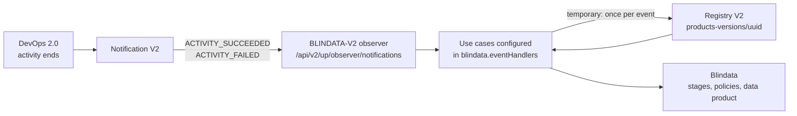

# Event Handling Configuration

The observer adapter reacts to Notification Events emitted by the Open Data Mesh Platform. Configure event
subscriptions with two levels of granularity:

## Notification and Registry API Version

To use **V2 events**, set in the [ODM Platform configuration](odm-platform-configurations.md):

- `odm.productPlane.notificationService.apiVersion: v2`

When notification service `apiVersion` is **v2**, the adapter uses a dual subscription model for backward compatibility:

- **Legacy (V1) events** (e.g. `DATA_PRODUCT_UPDATED`, activities, policies, marketplace): the adapter still subscribes with the **same observer name** (`subscribeWithName`), uses **V1 notification payloads**, and receives notifications on the **V1 consume endpoint** `/api/v1/up/observer/notifications`.
- **V2 events** (`DATA_PRODUCT_INITIALIZED`, `DATA_PRODUCT_DELETED`, `DATA_PRODUCT_VERSION_PUBLISHED`, `DATA_PRODUCT_VERSION_DELETED`, and the DevOps 2.0 activity outcomes `ACTIVITY_SUCCEEDED`, `ACTIVITY_FAILED`): the adapter subscribes with a **separate observer** whose name is `subscribeWithName` + **`-V2`** (e.g. `BLINDATA-V2`). These notifications use **V2 payloads** and are received on the **V2 consume endpoint** `/api/v2/up/observer/notifications`.

**Subscription behavior when apiVersion is v2:** The adapter subscribes using the **v2** event types where they exist: e.g. it subscribes to `DATA_PRODUCT_INITIALIZED` (not `DATA_PRODUCT_CREATED`) and `DATA_PRODUCT_VERSION_PUBLISHED` (not `DATA_PRODUCT_VERSION_CREATED`). Events that have the same name in both APIs (`DATA_PRODUCT_DELETED`, `DATA_PRODUCT_VERSION_DELETED`) are subscribed **only in v2** when notification apiVersion is v2 (so only the v2 notification stream is used for those). Events that have **no v2 equivalent** (e.g. `DATA_PRODUCT_UPDATED`, activities, policies, marketplace) are always subscribed via **v1** when included in the configuration, regardless of the notification api version.

- **Event Types**

  **V1 event types** (used when the platform sends V1 notifications; when apiVersion is v2, these are still consumed on the V1 endpoint):

  Supported V1 event types:
    - `DATA_PRODUCT_CREATED`
    - `DATA_PRODUCT_UPDATED`
    - `DATA_PRODUCT_DELETED`
    - `DATA_PRODUCT_VERSION_CREATED`
    - `DATA_PRODUCT_VERSION_DELETED`
    - `DATA_PRODUCT_ACTIVITY_CREATED`
    - `DATA_PRODUCT_ACTIVITY_STARTED`
    - `DATA_PRODUCT_ACTIVITY_COMPLETED`
    - `DATA_PRODUCT_TASK_CREATED`
    - `DATA_PRODUCT_TASK_STARTED`
    - `DATA_PRODUCT_TASK_COMPLETED`
    - `POLICY_CREATED`
    - `POLICY_UPDATED`
    - `POLICY_DELETED`
    - `MARKETPLACE_EXECUTOR_RESULT_RECEIVED`

  **V2 event types** (used when notification service `apiVersion` is v2; consumed on the V2 endpoint; use these values in `eventType` in event-handler config):

  - `DATA_PRODUCT_INITIALIZED`
  - `DATA_PRODUCT_DELETED`
  - `DATA_PRODUCT_VERSION_PUBLISHED`
  - `DATA_PRODUCT_VERSION_DELETED`
  - `ACTIVITY_SUCCEEDED` (emitted by DevOps 2.0, see [DevOps 2.0 events](#devops-20-events))
  - `ACTIVITY_FAILED` (emitted by DevOps 2.0, see [DevOps 2.0 events](#devops-20-events))

  An unrecognised V2 event type is logged at `warn` and closed as `PROCESSED`; it never breaks the queue.

  **V1 to V2 semantic mapping:** In v2, `DATA_PRODUCT_INITIALIZED` replaces `DATA_PRODUCT_CREATED`. It is emitted when the data product has been **created and approved**, not only created. Similarly, `DATA_PRODUCT_VERSION_PUBLISHED` replaces `DATA_PRODUCT_VERSION_CREATED`; it is emitted when the data product version has been **created and approved**, not only created.

- **Event Content Filtering**

  Use SpEL expressions to filter events by content. The same mechanism applies to both V1 and V2 handlers (the filter is evaluated against the event payload for that API version).
  E.g. An expression to capture an event regarding a data product ( match done by its fullyQualifiedName ).

  ```yaml
  blindata:
    eventHandlers: |
      [
        {
          "eventType": "DATA_PRODUCT_VERSION_CREATED",
          "filter": "#root['afterState']['info']['fullyQualifiedName'] == 'urn:org.opendatamesh:dataproducts:hrs:users'",
          "activeUseCases": [
            "DATA_PRODUCT_UPLOAD",
            "DATA_PRODUCT_VERSION_UPLOAD",
            "STAGES_UPLOAD",
            "POLICIES_UPLOAD"
          ]
        }
      ]
  ```

**Note:** _It is always mandatory to specify the event type._

## Available Actions

Configure the actions the observer will perform for each event:

For every subscription, it is possible to specify a set of actions that the observer will perform. These are:

| Action                                    | Description                                                                                                                 | Supported V1 Event Types                                          | Supported V2 Event Types                                           |
|-------------------------------------------|-----------------------------------------------------------------------------------------------------------------------------|-------------------------------------------------------------------|--------------------------------------------------------------------|
| `DATA_PRODUCT_UPLOAD`                     | Uploads the main information of the data product to Blindata and assigns ownership responsibilities to the designated user. When updating an existing data product, the version number is **not** updated and is preserved from the existing Blindata product. | `DATA_PRODUCT_CREATED`, `DATA_PRODUCT_VERSION_CREATED`, `DATA_PRODUCT_ACTIVITY_COMPLETED` | `DATA_PRODUCT_INITIALIZED`, `DATA_PRODUCT_VERSION_PUBLISHED`, `ACTIVITY_SUCCEEDED`, `ACTIVITY_FAILED` |
| `DATA_PRODUCT_VERSION_UPLOAD`             | Uploads the data product's ports metadata along with the assets specified in the descriptor API definitions. Also updates the data product version number in Blindata from the ODM descriptor. | `DATA_PRODUCT_VERSION_CREATED`, `DATA_PRODUCT_ACTIVITY_COMPLETED` | `DATA_PRODUCT_VERSION_PUBLISHED`, `ACTIVITY_SUCCEEDED`, `ACTIVITY_FAILED` |
| `QUALITY_UPLOAD`                          | Uploads the quality checks specified in the data product's ports metadata.                                                  | `DATA_PRODUCT_VERSION_CREATED`, `DATA_PRODUCT_ACTIVITY_COMPLETED` | `DATA_PRODUCT_VERSION_PUBLISHED`, `ACTIVITY_SUCCEEDED`, `ACTIVITY_FAILED` |
| `PROBES_UPLOAD`                           | Uploads executable CONTRACT_RULE quality probes to a Blindata probe project aligned with the Quality Suite name. Per-port opt-in via connection name (default property `x-blindataConnectionName`); ports without it skip probe upload. Runs after `QUALITY_UPLOAD` when both are active. Included by default for `DATA_PRODUCT_VERSION_CREATED`; remove it from `activeUseCases` to disable. | `DATA_PRODUCT_VERSION_CREATED`, `DATA_PRODUCT_ACTIVITY_COMPLETED` | `DATA_PRODUCT_VERSION_PUBLISHED`, `ACTIVITY_SUCCEEDED`, `ACTIVITY_FAILED` |
| `STAGES_UPLOAD`                           | Uploads the data product's stages which are defined inside the lifecycleInfo of the descriptor.                             | `DATA_PRODUCT_VERSION_CREATED`, `DATA_PRODUCT_ACTIVITY_COMPLETED` | `DATA_PRODUCT_VERSION_PUBLISHED`, `ACTIVITY_SUCCEEDED` (not `ACTIVITY_FAILED`) |
| `DATA_PRODUCT_REMOVAL`                    | Removes the **entire** data product from Blindata using the `dataProduct.fullyQualifiedName` from the event `beforeState`. | `DATA_PRODUCT_DELETED`                                            | `DATA_PRODUCT_DELETED`                                             |
| `DATA_PRODUCT_VERSION_REMOVAL`            | Handles data product version deletion events as a **no-op** in Blindata: it logs that a version was deleted in ODM but does not create, update, or delete any Blindata data product. | `DATA_PRODUCT_VERSION_DELETED`                                    | `DATA_PRODUCT_VERSION_DELETED`                                    |
| `POLICIES_UPLOAD`                         | Gathers all policy evaluation results for the specified data product and uploads them to Blindata.                          | `DATA_PRODUCT_VERSION_CREATED`, `DATA_PRODUCT_ACTIVITY_COMPLETED` | `DATA_PRODUCT_VERSION_PUBLISHED`, `ACTIVITY_SUCCEEDED`, `ACTIVITY_FAILED` |
| `POLICIES_ALIGN`                          | Aligns Blindata Governance Policy Suites, Policies, and Policies Implementations using Odm Policy External Context field.   | `POLICY_CREATED`, `POLICY_UPDATED`, `POLICY_DELETED`              | V1 only                                                            |
| `MARKETPLACE_ACCESS_REQUEST_PORTS_UPDATE` | Updates the grant status of the provider data product's ports in Blindata based on the result received from the platform.   | `MARKETPLACE_EXECUTOR_RESULT_RECEIVED`                            | V1 only                                                            |

**Notes:**

- `POLICIES_ALIGN` and `MARKETPLACE_ACCESS_REQUEST_PORTS_UPDATE` apply only to V1 events; there is no V2 equivalent in the current implementation.
- `STAGES_UPLOAD` supports only `ACTIVITY_SUCCEEDED` among the DevOps 2.0 events: on a failed activity it is refused as an unsupported event type, as V1 uploaded no stage when the activity did not complete.
- The version number handling differs between upload actions: `DATA_PRODUCT_UPLOAD` preserves the version when updating an existing product, while `DATA_PRODUCT_VERSION_UPLOAD` updates the version from the ODM descriptor.
- For deletion:
  - `DATA_PRODUCT_REMOVAL` uses only the `dataProduct` element of the event state and ignores any `dataProductVersion` field.
  - `DATA_PRODUCT_VERSION_REMOVAL` intentionally performs no Blindata-side mutation, ensuring that user-entered metadata on the Blindata data product is preserved when only a version is deleted in ODM.

## DevOps 2.0 events

DevOps 2.0 announces the outcome of every activity through the Notification service. The observer subscribes to the
outcomes that matter to Blindata (`ACTIVITY_SUCCEEDED`, `ACTIVITY_FAILED`) and reacts to them as it did to the V1
`DATA_PRODUCT_ACTIVITY_COMPLETED`. They are subscribed with the V2 observer (`BLINDATA-V2`) and consumed on
`/api/v2/up/observer/notifications`, so they require notification service `apiVersion: v2`.

### DevOps 2.0 event to observer action

| DevOps 2.0 event | Observer behaviour |
|---|---|
| `ACTIVITY_SUCCEEDED` | Handled. Runs the use cases configured for `ACTIVITY_SUCCEEDED`. `STAGES_UPLOAD` uploads one stage: the activity name, with the descriptor version. |
| `ACTIVITY_FAILED` | Handled. Runs the use cases configured for `ACTIVITY_FAILED`. `STAGES_UPLOAD` is not supported (no stage is uploaded for a failed activity). |
| `ACTIVITY_CANCELED` | Ignored (not subscribed). |
| `ACTIVITY_EXECUTION_REQUESTED` | Ignored (not subscribed). |
| `ACTIVITY_EXECUTION_APPROVED` | Ignored (not subscribed). |
| `ACTIVITY_EXECUTION_REJECTED` | Ignored (not subscribed). |
| `ACTIVITY_TASK_EXECUTION_REQUESTED` | Ignored (not subscribed). |
| `ACTIVITY_TASK_EXECUTION_APPROVED` | Ignored (not subscribed). |
| `ACTIVITY_TASK_EXECUTION_REJECTED` | Ignored (not subscribed). |

If one of the ignored events reaches the V2 endpoint anyway, the observer logs a warning, calls neither Registry nor
Blindata, and closes the notification as `PROCESSED`.

### Relation to the V1 activity event

| V1 | DevOps 2.0 |
|---|---|
| `DATA_PRODUCT_ACTIVITY_COMPLETED` with status `PROCESSED` | `ACTIVITY_SUCCEEDED` |
| `DATA_PRODUCT_ACTIVITY_COMPLETED` with status `FAILED` | `ACTIVITY_FAILED` |
| `DATA_PRODUCT_ACTIVITY_COMPLETED` with status `ABORTED` | `ACTIVITY_CANCELED` (ignored) |

- DevOps 2.0 has no counterpart of the V1 "activity started" or "stage transition" events, so there is nothing to map
  them to.
- The execution mode of the activity (Full Control or Instrumented) does not change the events, and the observer does
  not look at it.
- The stage version is the descriptor `info.version` (Registry V2 `versionNumber`), never the Registry Git tag. DevOps
  names this value `dataProductVersionNumber`.
- An activity name that is not a `lifecycleInfo` key is uploaded as a stage as-is, as it was in V1.

### Filtering on the activity

The V2 filter is evaluated against the V2 event, so the activity name is
`#root['eventContent']['activity']['name']`. In V1 it was `#root['afterState']['activity']['stage']`.

```yaml
- eventType: ACTIVITY_SUCCEEDED
  filter: "#root['eventContent']['activity']['name'] == 'prod'"
```

### Registry requirement (temporary)

DevOps 2.0 events carry the identity of the data product version but not its descriptor. To run the use cases the
observer reads the descriptor from Registry V2 (`GET /api/v2/pp/registry/products-versions/{uuid}`), once per event,
whatever the number of use cases. This requires, in the [ODM Platform configuration](odm-platform-configurations.md):

- `odm.productPlane.registryService.active: true`
- `odm.productPlane.registryService.apiVersion: v2`

Otherwise the notification ends as `FAILED_TO_PROCESS` with a "Registry V2 not configured" (or "Registry client is
disabled") message. The same happens when Registry does not know the version.

**This read is temporary.** It disappears once the events are enriched upstream (likely by the Notification service), at
which point the descriptor comes with the event and `registryService.apiVersion` is no longer needed for DevOps events.



### Reference configuration

No handler for the DevOps 2.0 events is packaged in `application.yml`. Use the mapping below, which mirrors the V1
`DATA_PRODUCT_ACTIVITY_COMPLETED` default (see Examples 4 and 5):

| Event | Use cases |
|---|---|
| `ACTIVITY_SUCCEEDED` | `STAGES_UPLOAD`, `POLICIES_UPLOAD` |
| `ACTIVITY_FAILED` | `POLICIES_UPLOAD` |

## Examples

Below are comprehensive examples of event handler configurations for different scenarios:

### Example 1: Basic Data Product Lifecycle Management

This configuration handles the complete lifecycle of a data product:

```yaml
blindata:
  eventHandlers: |
    [
      {
        "eventType": "DATA_PRODUCT_VERSION_CREATED",
        "filter":"",
        "activeUseCases": [
          "DATA_PRODUCT_UPLOAD",     
          "DATA_PRODUCT_VERSION_UPLOAD",
          "QUALITY_UPLOAD",
          "PROBES_UPLOAD",
          "STAGES_UPLOAD",
          "POLICIES_UPLOAD"
        ]
      },
      {
        "eventType": "DATA_PRODUCT_ACTIVITY_COMPLETED",
        "activeUseCases": [
          "STAGES_UPLOAD",
          "POLICIES_UPLOAD"
        ]
      }
    ]
```

### Example 2: Environment-Specific Deployment Strategy

This configuration employs a staged deployment strategy. Initially, basic data product information is uploaded upon the
creation of a version. Full details, however, are uploaded only after successful deployment. In this scenario, there are
two Blindata tenants: one for storing metadata from the development environment and another for the production
environment.

The configuration first uploads basic data product information when a version is created. Subsequently, it uploads
additional metadata, such as stages and policies, once activities are completed in the development environment. Finally,
it uploads comprehensive data product information, including ports and assets, when activities are completed in the
production environment.

**Note:** This configuration is intended for the production tenant. A separate observer with a distinct configuration
should be set up for the development tenant.

```yaml
blindata:
  eventHandlers: |
    [
      {
        "eventType": "DATA_PRODUCT_VERSION_CREATED",
        "activeUseCases": [
          "DATA_PRODUCT_UPLOAD"
        ]
      },
      {
        "eventType": "DATA_PRODUCT_ACTIVITY_COMPLETED",
        "filter": "#root['afterState']['activity']['stage'] == 'dev'",
        "activeUseCases": [
          "STAGES_UPLOAD",
          "POLICIES_UPLOAD"
        ]
      },
      {
        "eventType": "DATA_PRODUCT_ACTIVITY_COMPLETED",
        "filter": "#root['afterState']['activity']['stage'] == 'prod'",
        "activeUseCases": [
          "DATA_PRODUCT_UPLOAD",
          "DATA_PRODUCT_VERSION_UPLOAD",
          "STAGES_UPLOAD",
          "POLICIES_UPLOAD"
          ]
      }
    ]
```

### Example 3: Marketplace Integration

This configuration handles marketplace access request results:

```yaml
blindata:
  eventHandlers: |
    [
      {
        "eventType": "MARKETPLACE_EXECUTOR_RESULT_RECEIVED",
        "filter": "#root['afterState']['type'] == 'ACCESS_REQUEST_RESULT'",
        "activeUseCases": [
          "MARKETPLACE_ACCESS_REQUEST_PORTS_UPDATE"
        ]
      }
    ]
```

### Example 4: V2 Events (Notification and Registry apiVersion v2)

This configuration uses V2 event types. It applies when both notification service and registry are configured with `apiVersion: v2` (see [ODM Platform configuration](odm-platform-configurations.md)). V2 events are consumed on `/api/v2/up/observer/notifications`.

```yaml
blindata:
  eventHandlers: |
    [
      {
        "eventType": "DATA_PRODUCT_INITIALIZED",
        "filter": "",
        "activeUseCases": [
          "DATA_PRODUCT_UPLOAD"
        ]
      },
      {
        "eventType": "DATA_PRODUCT_VERSION_PUBLISHED",
        "filter": "",
        "activeUseCases": [
          "DATA_PRODUCT_UPLOAD",
          "DATA_PRODUCT_VERSION_UPLOAD",
          "QUALITY_UPLOAD",
          "PROBES_UPLOAD",
          "STAGES_UPLOAD",
          "POLICIES_UPLOAD"
        ]
      },
      {
        "eventType": "DATA_PRODUCT_DELETED",
        "activeUseCases": [
          "DATA_PRODUCT_REMOVAL"
        ]
      },
      {
        "eventType": "DATA_PRODUCT_VERSION_DELETED",
        "activeUseCases": [
          "DATA_PRODUCT_VERSION_REMOVAL"
        ]
      },
      {
        "eventType": "ACTIVITY_SUCCEEDED",
        "filter": "",
        "activeUseCases": [
          "STAGES_UPLOAD",
          "POLICIES_UPLOAD"
        ]
      },
      {
        "eventType": "ACTIVITY_FAILED",
        "filter": "",
        "activeUseCases": [
          "POLICIES_UPLOAD"
        ]
      }
    ]
```

The last two handlers react to the DevOps 2.0 activity outcomes. They need the Registry client with `active: true` and
`apiVersion: v2` (see [DevOps 2.0 events](#devops-20-events)).

### Example 5: DevOps 2.0 environment-specific

The DevOps 2.0 counterpart of Example 2. Activities of the `dev` stage upload stages and policy results. Activities of
the `prod` stage run the full upload: on success, everything including the stage; on failure, everything except stages
(`STAGES_UPLOAD` is not supported on `ACTIVITY_FAILED`).

```yaml
blindata:
  eventHandlers: |
    [
      {
        "eventType": "ACTIVITY_SUCCEEDED",
        "filter": "#root['eventContent']['activity']['name'] == 'dev'",
        "activeUseCases": [
          "STAGES_UPLOAD",
          "POLICIES_UPLOAD"
        ]
      },
      {
        "eventType": "ACTIVITY_SUCCEEDED",
        "filter": "#root['eventContent']['activity']['name'] == 'prod'",
        "activeUseCases": [
          "DATA_PRODUCT_UPLOAD",
          "DATA_PRODUCT_VERSION_UPLOAD",
          "QUALITY_UPLOAD",
          "PROBES_UPLOAD",
          "STAGES_UPLOAD",
          "POLICIES_UPLOAD"
        ]
      },
      {
        "eventType": "ACTIVITY_FAILED",
        "filter": "#root['eventContent']['activity']['name'] == 'dev'",
        "activeUseCases": [
          "POLICIES_UPLOAD"
        ]
      },
      {
        "eventType": "ACTIVITY_FAILED",
        "filter": "#root['eventContent']['activity']['name'] == 'prod'",
        "activeUseCases": [
          "DATA_PRODUCT_UPLOAD",
          "DATA_PRODUCT_VERSION_UPLOAD",
          "QUALITY_UPLOAD",
          "PROBES_UPLOAD",
          "POLICIES_UPLOAD"
        ]
      }
    ]
```
