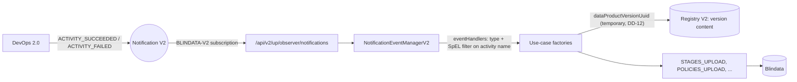

# SPDD Analysis: DevOps 2.0 events in the Blindata Observer

Story **BDMD-5558** (epic **BDMD-5097**). It depends on the DevOps 2.0 stories in `odm-platform-pp-devops-server`: **BDMD-5436** (Activity and Task CRUD), **BDMD-5437** (full control), **BDMD-5440** (cancel and error paths), **BDMD-5442** (instrumented path), **BDMD-5443** (CLI flow), and **BDMD-5438** (Policy V1 adapter). The UI side is **BDMD-5518** in `blindata-ui`, whose decision D-11 defers "Blindata outcome updates from DevOps V2" to this story.

**Revision 3 (2026-11-04, remaining answers).** Closes Q4, Q7, and Q9. No questions are open, and the design is ready for the REASONS Canvas.

- All six factories that handle V1 activity completion support the new events, for V1 parity (Q4, DD-4, DD-10).
- An unrecognised V2 event is logged at warn and closed as `PROCESSED` (Q7, DD-7).
- The "stage transition" from the story has nothing to map: DevOps 2.0 emits neither that event nor "activity started" (Q9, DD-13).

**Revision 2 (2026-11-04, team answers).** Closes Q1, Q2, Q3, Q5, Q6, Q8, and Q10.

- The event table is confirmed (Q1).
- `ACTIVITY_FAILED` keeps the V1 behaviour (Q2, DD-10): the use cases run on a failed activity, and the stage upload does nothing for it.
- `ACTIVITY_CANCELED` is ignored (Q3).
- The stage version is the descriptor's `info.version` (Q5, DD-11). In Registry V2 this is `versionNumber`, and in DevOps it is `dataProductVersionNumber`. It is never the Registry `tag`.
- Registry V2 is configured like the other ODM services. The Registry read is **temporary**: it goes away once another service, likely Notification, enriches the events (Q6, DD-5, DD-12).
- The Policy results lookup key is consistent, so no change is needed (Q8, DD-11).
- The subscription list stays hardcoded, as for the Registry V2 events (Q10, DD-2).

Q4, Q7, and Q9 were left open; revision 3 closes them.

**Revision 1 (2026-11-03, draft).** First pass. It took the list of DevOps 2.0 events from the DevOps code and docs and compared it with the observer's V2 event pipeline and use-case factories. It proposed a direction and listed the open questions. Decisions are numbered **DD-n** and questions **Q-n**, so later revisions can close them by ID.

## Original Business Requirement

### Story BDMD-5558 (verbatim, transcribed from the Jira screenshots)

```
BDMD-5097 / BDMD-5558

[ODM - Blindata Observer] Gestione nuovi eventi DevOps 2.0

Description

Contesto
DevOps 2.0 introduce un nuovo modello activity/task (una sola activity aperta per DP, execution mode Full Control vs
Instrumented) ed emette nuovi eventi tramite Notification 2.0 (es. «task execution requested», BDMD-5442). Già il 07/09 era
emerso che cambiare gli eventi (es. stage transition al posto di activity started) richiede di riprendere l'Observer e le mappature.
L'Observer Blindata oggi gestisce gli eventi v2 e del Registry v2 (BDMD-4712, 4850), ma non quelli del nuovo DevOps.

Obiettivo
L'Observer riceve, mappa e gestisce i nuovi eventi DevOps 2.0 riusando gli use case esistenti, senza regressioni sugli eventi
V1/Registry v2.

Scope
In
- Inventario degli eventi DevOps 2.0 emessi su Notification e del loro payload.
- Mapping sulle factory degli use case esistenti (stesso approccio di BDMD-4712) e servizio di gestione dei nuovi eventi.
- Sottoscrizione dell'Observer ai nuovi eventi.
- Test di integrazione con DevOps 2.0 per Full Control e Instrumented.
- Aggiornamento README/Mermaid degli eventi.

Out
- Modifiche al DevOps service o al modello eventi.
- Replay degli eventi sugli observer e audit trail di Notification (BDMD-5521).
- Policy V2 adapter (BDMD-5444).

Criteri di accettazione
[ ] Esiste una tabella evento DevOps 2.0 → azione Observer (o «ignorato»), condivisa con il team DevOps.
[ ] L'Observer gestisce tutti gli eventi della tabella, con test per ognuno.
[ ] Gli eventi V1 e Registry v2 continuano a funzionare (test di regressione verdi).
[ ] Un evento non riconosciuto viene loggato e non genera errori 5xx.
[ ] Flusso end-to-end verificato su ambiente dev in Full Control e Instrumented.

Dipendenze
- BDMD-5442 (fully instrumented path, in Review) e BDMD-5443 (flusso CLI): definiscono gli eventi.
- BDMD-5437 (full control), BDMD-5440 (cancel).

Domande aperte
1. Qual è la lista definitiva degli eventi DevOps 2.0 e il loro payload? Non è documentata in KB (in Jira compare solo «task
   execution requested»).
2. Cosa deve fare Blindata in risposta a ciascun evento (stato DP, issue, notifiche UI)?
3. Si mantiene la compatibilità con gli eventi DevOps V1 tramite l'adapter V1 (BDMD-5438)?
4. Serve gestire cancel/errori (409) come eventi distinti?

Fonti: BDMD-4712, 4850, 4968, 5442; blindata/knowledge raw/calls/2026-09-07-checkpoint-devops-2.md, raw/calls/2026-09-
30-devops-full-control-use-case.md, raw/calls/2025-12-15-review-policy-adapter.md, wiki/syntheses/blindata-
profile.md.
```

### Additional context from the request

> In this story we have to handle the events emitted by the new DevOps V2 and update Blindata. […] the story is auto-generated from calls transcripts, some inaccuracies may be present.

### Team answers (2026-11-04)

> Q1: Confirmed. Q2: Keep behavior as V1 did. Q3: ignore. Q5: yes, keep info version. Verify and double check which is the correct field from the Registry V2 resource. Q6: Yes, mirror Notification, Registry, etc. Keep the same pattern used in the other services. However, IMPORTANT: calling the Registry V2 is only a temporary solution. In the future the events will be enriched by another service (likely the notification), and the registry call as we implement it today will not be necessary then. Important to note this in the design and to document this in the code. Q8: verify which is the correct field to use in the Registry V2. Q10: Yes, follow pattern like the Registry V2 events.

### Sources consulted

- DevOps 2.0 analyses in `odm-platform-pp-devops-server/spdd/analysis/`:
  - BDMD-5437: the analysis and the interfaces document (sections 3.8, 4, and 7.4, and the event catalogue in DD-23 and DD-24);
  - BDMD-5440, BDMD-5442, and BDMD-5438.
- DevOps 2.0 code as implemented (last commit `f57bae5`, BDMD-5443): `docs/service/events.md`, `EventTypeRes`, the classes in `activity/events/emitted/*`, `ActivityRes`, `TaskRes`, and the Policy V1 adapter (`old/v1/policyservice/NotificationEventHandlerActivity*ExecutionRequested`).
- DevOps V1 (`odm-platform/product-plane-services/devops-server`): `ActivityService` and `DevOpsNotificationServiceProxy.notifyActivityCompletion`.
- Registry V2 (`odm-platform-pp-registry-server`):
  - `GET /api/v2/pp/registry/products-versions/{uuid}` in `DataProductVersionsController`;
  - `DataProductVersionRes`;
  - `DataProductVersionPublisher`, where `versionNumber` is extracted from the descriptor;
  - the Policy V1 adapter, `NotificationEventHandlerDpvPublicationRequested`.
- ODM CLI: `odm-cli/spdd/analysis/BDMD-5443-…-devops-v2-cli-commands.md` (Q10 and lookup) and `odm-cli/agents-reports/BDMD-5443-registry-scout.md`, `BDMD-5443-registry-v2-client-scout.md`.
- UI: `blindata-ui/spdd/analysis/BDMD-5518-…-devops-v2-ui-support.md` (D-1, D-6, D-11, D-27) and `ExecuteDevOpsV2ActivityFlow.js`.
- Observer:
  - the V1 and V2 consume paths and `OdmObserverClientConfigs`;
  - `OdmRegistryClientConfigs` and `OdmRegistryClientImpl`;
  - the use-case factories;
  - `application.yml` and `docs/configuration/event-handling.md`.

## Domain Concept Identification

### Existing Concepts (from codebase)

- **V2 event pipeline (observer).**
  - The request path is `OdmPlatformConsumeControllerV2Impl` (`POST /api/v2/up/observer/notifications`) → `NotificationEventConsumerServiceV2` → `NotificationEventManagerV2` → one `UseCasesExecutionTemplateV2` per configured handler → `UseCaseFactory.getUseCaseV2(EventV2)` → use case.
  - `NotificationEventConsumerServiceV2` holds a single in-memory queue. It processes the queue asynchronously and answers `PROCESSING` at once.
  - When processing ends, the final status (`PROCESSED`, or `FAILED_TO_PROCESS` with the error message) is written back to Notification.
- **Internal V2 event (`EventV2`, `EventTypeV2`).** The envelope holds `type`, `resourceType`, `resourceIdentifier`, `eventTypeVersion`, and `eventContent` as JSON. `EventTypeV2` has only the four Registry V2 types: `DATA_PRODUCT_INITIALIZED`, `DATA_PRODUCT_DELETED`, `DATA_PRODUCT_VERSION_PUBLISHED`, and `DATA_PRODUCT_VERSION_DELETED`.
- **Event handler configuration (`blindata.eventHandlers`).**
  - It is a list of `{ eventType, filter, activeUseCases }`, shared by the V1 and V2 managers.
  - The filter is a SpEL expression over the serialized event.
  - The configuration decides which use cases run for an event. The factories only declare which event types they can build a use case from.
- **Use-case factories.** Each factory declares `supportedEventTypes` (V1) and `supportedEventTypesV2`, and turns the event into the use case's ODM outbound port. The V2 branches today read the Registry V2 event content. That content embeds the data product version and its descriptor (`DataProductVersionPublishedEventContentResource.dataProductVersion.content`), which the factories parse into a `DataProductVersion`.
- **V1 DevOps handling (the behaviour to keep).**
  - DevOps V1 emitted `DATA_PRODUCT_ACTIVITY_CREATED/STARTED/COMPLETED` and `DATA_PRODUCT_TASK_CREATED/STARTED/COMPLETED`. Their state (`ActivityEventState`) embedded the activity (`stage`, `status`) **and the full data product version descriptor**.
  - `DATA_PRODUCT_ACTIVITY_COMPLETED` was emitted for **every** terminal status: `PROCESSED`, `FAILED`, and `ABORTED` (`ActivityService`, three `notifyActivityCompletion` call sites).
  - Six factories support it: `DATA_PRODUCT_UPLOAD`, `DATA_PRODUCT_VERSION_UPLOAD`, `QUALITY_UPLOAD`, `PROBES_UPLOAD`, `STAGES_UPLOAD`, and `POLICIES_UPLOAD`.
  - Only `STAGES_UPLOAD` looks at the status: it uploads only for `PROCESSED`. The other five run whatever the status is, unless a configuration filter restricts them.
  - The default configuration maps the event to `STAGES_UPLOAD` + `POLICIES_UPLOAD`. The documented "environment-specific" example filters on `afterState.activity.stage`: `dev` runs stages and policies, and `prod` runs the full upload.
- **Stages upload with an activity.** `StagesUploadOdmOutboundPortImpl` uploads one Blindata stage only when the activity is `PROCESSED`. The stage `name` is the activity stage and the `version` is the descriptor's `info.version`. Without an activity, it uploads every `lifecycleInfo` key of the descriptor, with its order.
- **Policies upload.** It reads the Policy evaluation results by the descriptor's `info.id` and `info.version`, then uploads them to Blindata.
- **Subscription.**
  - With Notification `apiVersion: v2`, `OdmObserverClientConfigs` subscribes twice:
    - the V1 types, including the six V1 DevOps types, as observer `BLINDATA` on the V1 endpoint;
    - the four V2 types as `BLINDATA-V2` on the V2 endpoint.
  - Both lists are hardcoded and do not follow the handler configuration. This stays the pattern (Q10).
- **ODM service configuration.**
  - Every ODM client has `odm.productPlane.<service>.active` and `address`. When `active` is false, a stub logs and returns an empty result.
  - Notification also has `apiVersion` (`v1` default, `v2`), and `OdmObserverClientConfigs` switches on it.
  - The Registry has no `apiVersion`, and `OdmRegistryClient` calls only Registry V1 (`/api/v1/pp/registry/...`). The Registry V2 server still serves those old V1 routes.
- **Unknown V2 type today.**
  - `EventTypeV2.valueOf` throws inside the async worker.
  - The HTTP call has already returned `PROCESSING`, so there is no 5xx.
  - The exception escapes `processNotification`, so the notification is written back without a final status.
  - Only types the observer subscribed to can arrive, so this happens only through misconfiguration or a change in what Notification dispatches.

### DevOps 2.0 event inventory (from the DevOps code, not from KB)

All events have `resourceType = ACTIVITY`, `resourceIdentifier` = the activity UUID, and `eventTypeVersion = V2.0.0`. The execution mode, full control or instrumented, does **not** change the set of events or their shape. It appears only as `executionMode` on each task (BDMD-5518 D-27).

| Event | Emitted by | When | `eventContent` |
|---|---|---|---|
| `ACTIVITY_EXECUTION_REQUESTED` | DevOps | Execute Activity (UI or CLI) | `activity` (with tasks, without logs and results) |
| `ACTIVITY_EXECUTION_APPROVED` | Policy V1 adapter in DevOps, or DevOps auto-approve | Activity may start | activity identifiers only |
| `ACTIVITY_EXECUTION_REJECTED` | Policy V1 adapter | Activity refused; it then fails | activity identifiers only |
| `ACTIVITY_TASK_EXECUTION_REQUESTED` | DevOps | Next full-control task (Advance Activity), or CLI request for an instrumented task | `activity` + `task` |
| `ACTIVITY_TASK_EXECUTION_APPROVED` | Policy V1 adapter, or auto-approve | Task may run | activity + task identifiers |
| `ACTIVITY_TASK_EXECUTION_REJECTED` | Policy V1 adapter | Task refused; it and its activity fail | activity + task identifiers |
| `ACTIVITY_SUCCEEDED` | DevOps (Advance Activity) | Every task succeeded | `activity` (final, with tasks, without logs and results) |
| `ACTIVITY_FAILED` | DevOps (Advance Activity, Reject use cases) | A task failed, or Policy rejected the activity or a task | `activity` (final) |
| `ACTIVITY_CANCELED` | DevOps (Advance Activity after Cancel) | The owner canceled the activity | `activity` (final) |

The embedded `activity` carries:

- `uuid` and `dataProductVersionUuid`;
- `dataProductFqn` and `dataProductVersionNumber` (see the version identifiers below);
- `name`, the lifecycle stage (BDMD-5518 D-6);
- `sortOrder`, the position of the stage in `lifecycleInfo`;
- `status`, `startedAt`, and `finishedAt`;
- `tasks[]`, each with `uuid`, `name`, `sortOrder`, `status`, `providerRunId`, `executorName`, `executionMode`, `executorParameters`, `pipelineParameters`, and timestamps.

**No event carries the data product version descriptor.** DevOps 2.0 does not read descriptors, by design (BDMD-5437 DD-29).

DevOps 2.0 has no "activity started", "task started", "task completed", or "stage transition" event. The BDMD-5437 analysis already names the Blindata observer as the consumer of the three terminal activity events.

### Version identifiers across services (verified in revision 2)

The word "tag" means two different things across the services. The rows below are the same value unless the table says otherwise.

| Service | Field | Meaning | Source |
|---|---|---|---|
| Descriptor | `info.version` | The data product version, for example `1.2.0` | DPDS |
| Registry V2 | `DataProductVersionRes.versionNumber` | **Same value as `info.version`.** It is taken from the descriptor at publish. | `DataProductVersionPublisher` (`descriptorHandlerPort.extractVersionNumber`) |
| Registry V2 | `DataProductVersionRes.tag` | **The release's Git tag.** It is not the version number. DevOps uses it as the executor `ref`. | BDMD-5443 CLI analysis, "versionNumber" note |
| DevOps 2.0 | `ActivityRes.dataProductVersionNumber` | **Same value as `info.version`.** It is not the Git tag. | UI `ExecuteDevOpsV2ActivityFlow.js` sends `release.content.info.version`. The CLI sends `--data-product-version` = `info.version` = Registry `versionNumber` (BDMD-5443 Q10, Q24). |
| Policy V1 (from Registry V2) | evaluation `dataProductVersion` | `versionNumber` | Registry `NotificationEventHandlerDpvPublicationRequested` |
| Policy V1 (from DevOps 2.0) | evaluation `dataProductVersion` | `dataProductVersionNumber`, so `info.version` | DevOps `NotificationEventHandlerActivity*ExecutionRequested` (BDMD-5438 DD-7) |
| Observer | Policies upload filter and stage version | descriptor `info.version` | `PoliciesUploadOdmOutboundPortImpl`, `StagesUploadOdmOutboundPortImpl` |

The `dataProductId` key is consistent too. DevOps, Registry, and the descriptor parser all use the fqn-derived name UUID (BDMD-5438 DD-7), and the observer queries by `info.id`.

### New Concepts Required

- **DevOps V2 event types in the observer.** `ACTIVITY_SUCCEEDED` and `ACTIVITY_FAILED` become known V2 event types. They can be configured in `blindata.eventHandlers` like the Registry V2 types (DD-2).
- **DevOps activity event content.** This is the observer's view of the `activity` inside the event: the identity of the data product version, the stage name, the status, and the tasks. It plays the role `OdmActivityResource` plays for V1.
- **Data product version resolution (temporary).**
  - The event carries only the version's identity. The descriptor-based use cases therefore read the version from Registry V2 (`GET /api/v2/pp/registry/products-versions/{dataProductVersionUuid}`) and parse its `content` the way the `DATA_PRODUCT_VERSION_PUBLISHED` branch does.
  - This is the main structural difference from V1, where DevOps embedded the descriptor.
  - It is a **temporary bridge**. The target design is that another service, likely Notification, enriches the DevOps events with the version. When that happens, the observer reads the descriptor from the event again, and the Registry call is removed (DD-12).
- **Registry V2 client configuration.** `odm.productPlane.registryService.apiVersion`, following Notification's `apiVersion` (DD-5, Q6).
- **Event → observer action table.** The table that AC 1 requires. In this codebase it takes two forms:
  - which use cases each factory *can* build from each DevOps event (code);
  - the default `eventHandlers` configuration and the docs (YAML and Markdown).

### Key Business Rules

- **The observer keeps the V1 behaviour on activity outcomes (Q2).**
  - A finished activity runs the configured use cases.
  - The stage is uploaded only for a successful activity.
  - The other use cases also run on a failed activity, as they did when V1 `DATA_PRODUCT_ACTIVITY_COMPLETED` arrived with `FAILED`. In particular, the policy results of a rejected or failed activity reach Blindata.
- **A canceled activity changes nothing in Blindata (Q3).** This is a deliberate difference from V1, where `ABORTED` also arrived as `DATA_PRODUCT_ACTIVITY_COMPLETED`.
- **The activity name is the stage.** The UI sends the lifecycle stage key as the activity name (BDMD-5518 D-6). That value is uploaded as the Blindata stage name, and configuration filters test it in place of V1 `activity.stage`.
- **The stage version is the descriptor's `info.version` (Q5).** It is never the Registry `tag`, which is the Git tag.
- **Execution mode is irrelevant to the observer.** Full control and instrumented produce the same events. The observer has no branch on the mode. The two modes matter only for the end-to-end check.
- **Event handler configuration stays the single switch.** Configuration decides which use cases run on a DevOps event, and for which stage, as for every other event. Code only states what is possible.
- **Unrecognised events never break processing.** They are logged, the notification reaches a final status, and they never produce an HTTP error.
- **No regression on V1 and Registry V2.** The V1 consume path and the V1 DevOps types stay as they are, so a platform still on DevOps V1 keeps working. The Registry V2 handlers keep their behaviour.
- **Implicit: the data product must already exist in Blindata.**
  - The descriptor-based use cases already skip with a warning when the data product is not on Blindata.
  - DevOps V2 runs only on published (Registry V2) versions. The `DATA_PRODUCT_VERSION_PUBLISHED` handler has therefore normally created the data product first.

## Strategic Approach

### Solution Direction

Follow the BDMD-4712/4850 pattern used for the Registry V2 events:

- extend the V2 event vocabulary;
- teach the relevant factories to build their ODM outbound port from the new events;
- subscribe the `-V2` observer to them;
- document the default mapping.

Data flow for a DevOps outcome event:



1. **Event types.** Add `ACTIVITY_SUCCEEDED` and `ACTIVITY_FAILED` to the V2 event vocabulary and to the hardcoded `-V2` subscription list (DD-2).
2. **Factories.** The factories that support V1 activity completion also support the two new types (DD-4, DD-10): all six support `ACTIVITY_SUCCEEDED`, and all except `STAGES_UPLOAD` support `ACTIVITY_FAILED`.
3. **Descriptor.** A single shared component gets the data product version from Registry V2 by the activity's `dataProductVersionUuid`. It parses the `content` the same way the `DATA_PRODUCT_VERSION_PUBLISHED` branch does, so the use cases receive the same `DataProductVersion` (DD-5). The component is marked and documented as temporary (DD-12).
4. **Stages.** On `ACTIVITY_SUCCEEDED`, `STAGES_UPLOAD` uploads one stage: the activity name, with the descriptor's `info.version` (DD-11). On `ACTIVITY_FAILED` it uploads nothing, as V1 did for a non-`PROCESSED` activity.
5. **Unknown events.** The V2 pipeline tolerates a type it does not know. It logs the event at warn, closes the notification as `PROCESSED`, and does not throw (DD-7).
6. **Docs.** Add the event table, filter examples on the V2 payload (`#root['eventContent']['activity']['name'] == 'prod'`), the Registry `apiVersion` setting, and a Mermaid diagram of the DevOps → Notification → observer flow to `docs/configuration/event-handling.md`. Link them from the README.

### Key Design Decisions

- **DD-1: The observer consumes the DevOps V2 events natively, with no V1 compatibility layer.**
  - BDMD-5438 is a *Policy* adapter: it turns DevOps V2 requests into Policy V1 evaluations. It does not emit V1 DevOps events (`DATA_PRODUCT_ACTIVITY_*`) for observers. Once DevOps V2 is deployed, the V1 activity events are no longer emitted.
  - This answers story question 3: no, compatibility is not kept through BDMD-5438.
  - The V1 DevOps types and their handling stay as they are for platforms still on DevOps V1.
- **DD-2: The observer knows and subscribes to `ACTIVITY_SUCCEEDED` and `ACTIVITY_FAILED` only** *(revised in revision 2: Q1, Q3, Q10)*.
  - The two types are added to `EventTypeV2` and to the hardcoded `eventTypesV2ToSubscribe` list, as the Registry V2 events are.
  - `ACTIVITY_CANCELED` and the six approval events are not subscribed. The docs table lists them as "ignored".
  - **Pattern:** `OdmObserverClientConfigs.eventTypesV2ToSubscribe`.
- **DD-3: `ACTIVITY_SUCCEEDED` replaces `DATA_PRODUCT_ACTIVITY_COMPLETED` with `PROCESSED`.**
  - The default configuration is the same as V1: `STAGES_UPLOAD` + `POLICIES_UPLOAD`.
  - Each outcome now has its own event, so the V1 status check inside the stages port becomes a check of the event type. Whether to keep a status check as a safety net is a Canvas detail.
- **DD-4: The factories support the new events for every use case that supported V1 activity completion** *(confirmed in revision 3: Q4)*.
  - That is all six factories, not only the two in the default configuration: `DATA_PRODUCT_UPLOAD`, `DATA_PRODUCT_VERSION_UPLOAD`, `QUALITY_UPLOAD`, `PROBES_UPLOAD`, `STAGES_UPLOAD`, and `POLICIES_UPLOAD`. The cost is more V2 branches.
  - The benefit is that every V1 configuration has a V2 equivalent, including the documented "environment-specific" example (prod → full upload).
- **DD-5: The descriptor comes from Registry V2, read once per event, behind the standard ODM client configuration** *(revised in revision 2: Q6)*.
  - The event carries only `dataProductVersionUuid`, `dataProductFqn`, and `dataProductVersionNumber`. Five of the six use cases need the descriptor: `info`, the ports, and `lifecycleInfo`.
  - **Resolution:** one shared component, used by the factories and memoised per event. One event with six active use cases therefore makes one Registry call.
    - Rejected: each factory calling Registry on its own, because it multiplies the calls.
    - Rejected: enriching the event in the V2 manager before the handlers run. It would call Registry for every DevOps event, even one that no handler matches, and it would put a domain read into the generic pipeline.
  - **Source field:** `GET /api/v2/pp/registry/products-versions/{uuid}`, then `content`, parsed like `DataProductVersionPublishedEventContentResource.dataProductVersion.content`. This is the same unresolved descriptor the `DATA_PRODUCT_VERSION_PUBLISHED` event carries. The `/resolve` endpoint (`resolvedContent`) is not used, so that both events give the use cases the same input.
  - **Configuration:**
    - `odm.productPlane.registryService.apiVersion` (`v1` by default, or `v2`), following `odm.productPlane.notificationService.apiVersion`. `active` and `address` are unchanged.
    - `OdmRegistryClientConfigs` selects on it the way `OdmObserverClientConfigs` does. The existing V1 reads (`getApis`, `getApi`, `getDataProductVersion`) keep their current routes, which the Registry V2 server still serves.
    - With the Registry inactive, the stub's V2 read reports that the Registry is not configured. The notification then fails with that message, and no use case runs on missing data.
    - The exact bean layout is a Canvas detail.
  - **Failure:** a Registry error or a 404 becomes a `UseCaseInitException`, and the notification becomes `FAILED_TO_PROCESS` with the message, as happens today for a malformed payload.
- **DD-6: SpEL filters address the V2 payload.** V2 filters run on the serialized `EventV2`. A stage filter therefore reads `#root['eventContent']['activity']['name']`, not V1's `#root['afterState']['activity']['stage']`. No new filter mechanism is needed, and the docs show examples.
- **DD-7: Unrecognised V2 events are logged and closed as `PROCESSED`, never thrown** *(confirmed in revision 3: Q7)*.
  - A type outside `EventTypeV2` is logged at warn, and the notification is written back as `PROCESSED`.
  - An unknown type is not a processing error: there is nothing to retry, and a BDMD-5521 replay would only fail it again. `FAILED_TO_PROCESS` stays reserved for real failures, such as a Registry error (DD-5).
  - The HTTP response does not change: it is already `PROCESSING`, with status 200.
  - This also covers `ACTIVITY_CANCELED` or an approval event if Notification ever dispatches one to the observer.
- **DD-8: No branch on execution mode.**
  - Full control and instrumented differ only inside DevOps.
  - The integration tests feed the same outcome events with tasks of both modes.
  - The end-to-end check on dev runs one activity per mode (AC 5).
- **DD-9: The V1 path is not modified.** The existing V1 and V2 ITs (`rest/v1`, `rest/v2`) guard against regressions. New V2 ITs, one per DevOps event, follow `ObserverBlindataNotificationV2IT`.
- **DD-10: `ACTIVITY_FAILED` behaves like V1 `DATA_PRODUCT_ACTIVITY_COMPLETED` with `FAILED`** *(new in revision 2: Q2)*.
  - The factories that run on any status in V1 support `ACTIVITY_FAILED`: `DATA_PRODUCT_UPLOAD`, `DATA_PRODUCT_VERSION_UPLOAD`, `QUALITY_UPLOAD`, `PROBES_UPLOAD`, and `POLICIES_UPLOAD` (scope confirmed in revision 3: Q4).
  - `STAGES_UPLOAD` uploaded nothing for a failed activity in V1, so it does not need to support `ACTIVITY_FAILED`.
  - The default configuration maps `ACTIVITY_FAILED` to `POLICIES_UPLOAD`. That is V1's default (`STAGES_UPLOAD` + `POLICIES_UPLOAD` on any completion) minus the stages step, which did nothing on a failure. A Policy rejection, which ends the activity as `FAILED`, therefore shows the failing evaluation in Blindata.
  - Configurations that want V1's "prod" behaviour also on failures add `ACTIVITY_FAILED` handlers. The docs say so explicitly.
- **DD-11: Version identifiers** *(new in revision 2: Q5, Q8)*.
  - The Blindata stage version is the descriptor's `info.version`, which Registry V2 exposes as `versionNumber`. The Registry `tag` is the Git tag and is never used as a version.
  - The Policy results lookup stays on `info.id` + `info.version`. DevOps (`dataProductVersionNumber`, filled with `info.version` by the UI and the CLI) and Registry V2 (`versionNumber`) both store evaluations under that same value. No change is needed.
  - The observer-side field has the DevOps name, `dataProductVersionNumber`, so no JSON mapping is needed.
- **DD-12: The Registry call is a temporary bridge** *(new in revision 2: Q6)*.
  - The target design is that DevOps events reach observers already enriched with the data product version, most likely by Notification. The observer then reads the descriptor from the event, as it does for `DATA_PRODUCT_VERSION_PUBLISHED`, and the Registry V2 read for DevOps events is deleted.
  - To keep that removal local:
    - the Registry read lives only in the shared resolution component of DD-5 and the Registry V2 client method it uses;
    - factories and use cases depend on the resolved `DataProductVersion`, never on the Registry client;
    - the component's Javadoc, and the client method's, state that the read is temporary, why it exists (DevOps 2.0 events carry no descriptor), and what replaces it (events enriched upstream);
    - the docs say the same next to the `apiVersion` setting.
  - Rejected: building a general-purpose Registry V2 client surface for this story. Only the single version read is added.
- **DD-13: No "stage transition" or "activity started" mapping** *(new in revision 3: Q9)*.
  - The story's "stage transition instead of activity started" (07/09 call) has no counterpart in DevOps 2.0: it emits neither event, and BDMD-5438 does not send `ACTIVITY_STAGE_TRANSITION`.
  - The V1 default configuration never used `ACTIVITY_STARTED` either, so nothing is lost. The stage is uploaded on the outcome (`ACTIVITY_SUCCEEDED`, DD-3).

### Alternatives Considered

- **Ask DevOps to embed the descriptor in its outcome events.** Rejected. The story scope excludes changes to DevOps and to the event model, and DevOps does not read descriptors by design (BDMD-5437 DD-29). BDMD-5438 rejects enrichment by the producer for the same reason. Enrichment by a platform service is the future direction (DD-12), but it is outside this story.
- **Read the descriptor through Registry V1** (`/products/{id}/versions/{number}`, with the fqn-derived id and `dataProductVersionNumber`). This is technically possible, because `dataProductVersionNumber` is the version number (DD-11). Rejected anyway: DevOps V2 requires Registry V2 (BDMD-5518 D-1), and the V2 read is a single call by the UUID the event already carries.
- **Re-emit V2 outcomes as V1 `DATA_PRODUCT_ACTIVITY_COMPLETED` inside the observer and reuse the V1 branches.** Rejected. It would rebuild V1 state the V2 event does not have, and keep V1 names alive in the configuration.
- **A new "DevOps outcome" use case instead of extending the factories.** Rejected. The story asks to reuse the existing use cases, and the behaviour wanted (stages, policies, uploads) already exists.
- **Subscribe to every DevOps event, with the approval and cancel events mapped to "ignored".** Rejected in revision 2 (Q1, Q3). It brings in traffic the observer does nothing with.
- **Subscription driven by the configured handlers.** Rejected (Q10). The Registry V2 types are hardcoded, and this story follows that pattern.

## Risk & Gap Analysis

### Closed in revision 2

| Id | Answer |
|----|--------|
| Q1 | The table is confirmed: `ACTIVITY_SUCCEEDED` → `STAGES_UPLOAD` + `POLICIES_UPLOAD` (other use cases through configuration); `ACTIVITY_FAILED` → behaves as in V1 (DD-10); `ACTIVITY_CANCELED` and the six approval events → not subscribed, ignored. Blindata issues and UI notifications are out of scope. |
| Q2 | Keep the V1 behaviour. The use cases run on a failed activity as they did on V1 completion with `FAILED`, and stages do nothing for it (DD-10). |
| Q3 | `ACTIVITY_CANCELED` is ignored. The 409 in the story is an HTTP response from DevOps, not an event. |
| Q5 | The stage version is `info.version`. In Registry V2 this is `versionNumber`, not `tag` (DD-11, version identifiers table). |
| Q6 | Registry V2 is configured with `apiVersion`, following Notification. The Registry call is temporary, and the design isolates and documents it (DD-5, DD-12). |
| Q8 | No mismatch. DevOps' `dataProductVersionNumber` holds `info.version` (from the UI and the CLI), and Registry V2 sends `versionNumber` to Policy. Both equal the observer's `info.version` key (DD-11). |
| Q10 | The subscription list stays hardcoded, as for the Registry V2 events (DD-2). |

### Closed in revision 3

| Id | Answer |
|----|--------|
| Q4 | All six factories that handle V1 activity completion support the new events, for full V1 configuration parity (DD-4, DD-10). |
| Q7 | An unrecognised V2 event is logged at warn and closed as `PROCESSED` (DD-7). |
| Q9 | Nothing to map: DevOps 2.0 emits neither "stage transition" nor "activity started" (DD-13). |

### Requirement Ambiguities

None open. The design is ready for the REASONS Canvas.

### Edge Cases

- **The data product is not yet on Blindata**, because the `DATA_PRODUCT_VERSION_PUBLISHED` handler failed or is not configured. The use cases already log a warning and return, and the notification ends `PROCESSED`.
- **The version is deleted in Registry between the end of the activity and the processing of the event.** Registry returns 404 and the notification becomes `FAILED_TO_PROCESS` with the message. A BDMD-5521 replay, out of scope, would fail again.
- **The Registry is inactive, or `apiVersion` is not `v2`, while DevOps V2 events are configured.** The notification fails with a clear "Registry V2 not configured" message (DD-5). The docs state that DevOps V2 events need Registry `apiVersion: v2`.
- **Two activities of the same version end together** (different names can run at the same time, BDMD-5437 DD-12).
  - The observer's queue processes the events one at a time, and each event uploads its own stage.
  - Uploading a partial list (one stage) must not delete the other stages in Blindata. The behaviour is the same as V1; to be verified.
- **An activity is canceled after a task succeeded, or a failure arrives too late** (BDMD-5440 DD-40). The event is whatever outcome DevOps finally decided. A canceled activity is ignored (Q3), and a late failure follows DD-10.
- **A policy rejects an activity before it runs.** The outcome is `ACTIVITY_FAILED`, with no task run. `POLICIES_UPLOAD` uploads the failed evaluation (DD-10), and stages do nothing.
- **A stage is executed again.** "Execute again" creates a new activity. A second `ACTIVITY_SUCCEEDED` for the same stage uploads the same stage again, which is idempotent, as in V1.
- **The activity name is not a `lifecycleInfo` key.** This can happen with an activity created by the CLI (BDMD-5442), which builds the request body itself. The uploaded stage would not match the descriptor's stage list. Accept it, or check the name against `lifecycleInfo` (Canvas)?
- **A filter reads a field missing from the payload**, for example a V1-style filter on a V2 type. The handler does not match and an error is logged. The notification ends `PROCESSED` with no action, so the docs must show V2 filters.
- **An event contains tasks of both modes.** The mode does not matter to the observer (DD-8). A test covers it, so that a future change does not branch on the mode by accident.

### Technical Risks

- **A new Registry V2 dependency.**
  - Every handled DevOps outcome now needs the Registry to be reachable from the observer.
  - Mitigation: one read per event (DD-5), a clear failure message, and documented configuration.
  - The dependency is temporary (DD-12).
- **The temporary bridge outlives its purpose.** If the Registry read leaks into factories or use cases, removing it later touches many classes. Mitigation: the isolation rules and code comments of DD-12.
- **Confusing the version number with the Git tag.** DevOps' `dataProductVersionNumber` holds the version number, not the Git tag. Using Registry's `tag` by mistake would silently break the stage version and the Policy lookup. Mitigation: DD-11, and a test whose `tag` differs from its `versionNumber`.
- **Payload drift.** The DevOps event content is mapped from `ActivityRes`, so new fields such as `executionMode` (added by BDMD-5518 D-27) must be ignored. The observer must deserialize with unknown properties ignored, as it already does for V1 states.
- **Unknown-type handling touches the shared V2 consumer.** Changing exception handling in `NotificationEventConsumerServiceV2` also affects the Registry V2 events. The existing V2 ITs cover this (DD-9).
- **The queue under concurrency.** `ConcurrentObserverBlindataNotificationV2IT` exercises the queue, and the new event types must not change its ordering assumptions.
- **The end-to-end check needs a full stack.**
  - It needs DevOps V2 with the starter executor, Notification V2, Registry V2, Policy inactive or at V1, Blindata, and the CLI for the instrumented mode.
  - This is environment work outside the code, and it depends on BDMD-5443 being deployed to dev.

### Acceptance Criteria Coverage

| AC# | Description | Addressable? | Gaps/Notes |
|-----|-------------|--------------|------------|
| 1 | A DevOps 2.0 event → observer action (or "ignored") table exists, shared with the DevOps team | Yes | The table is confirmed (Q1). It goes into `docs/configuration/event-handling.md`. Sharing it with DevOps is a process step. |
| 2 | The observer handles every event in the table, with a test for each | Yes | One V2 IT per subscribed event (`ACTIVITY_SUCCEEDED`, `ACTIVITY_FAILED`) and use case. A test checks that an ignored or unknown type ends without action. All six factories are covered for `ACTIVITY_SUCCEEDED`, and all except `STAGES_UPLOAD` for `ACTIVITY_FAILED` (Q4). |
| 3 | V1 and Registry V2 events keep working (regression tests green) | Yes | DD-9. The existing `rest/v1` and `rest/v2` ITs, plus the Registry client change (DD-5), are checked against the existing V1 reads. |
| 4 | An unrecognised event is logged and does not cause a 5xx | Yes | DD-7. The HTTP response is already 200; the fix closes the notification as `PROCESSED` on the async path (Q7). |
| 5 | End-to-end flow verified on dev in Full Control and Instrumented | Partial | DD-8: the code does not differ between the modes. The check needs the dev environment with DevOps V2 and the CLI (BDMD-5443). It is a manual check, not an automated test. |
| — | Scope item: README/Mermaid for the events | Yes | There is no Mermaid diagram today. One is added to the event-handling docs and linked from the README. |
