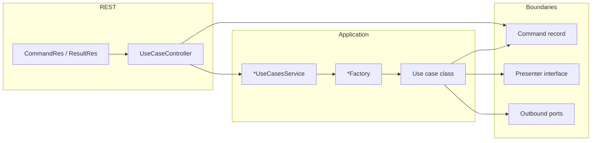

# Guidelines: Implementing a Use Case

This document describes how use cases are structured: REST surface, application orchestration, factories, domain commands, presenters, and outbound ports.

## Architecture at a glance

The flow is:

**HTTP** → **Controller** (`*UseCaseController`, maps `*CommandRes` → command) → **Use cases service** (`*UseCasesService`) → **Factory** (`*Factory`) → **Use case** (implements `UseCase`) → **Outbound ports** (interfaces) → **Adapters** (`*OutboundPortImpl`) → **Core services / clients**.

- The **use case** stays free of Spring and HTTP: it receives a **command** (domain input), talks to the outside world only through **ports**, and reports results and failures only through its **presenter**.
- The **presenter** is the use case’s output boundary: it receives domain results (e.g. `presentX(...)`) and failures (`presentException(...)`).
- The **factory** is the composition root for a single use case: it wires concrete port implementations and returns a `UseCase` instance.
- The **controller** maps REST DTOs to the command and the domain result back to API resources, with its version's mappers. The **use cases service** builds the presenter, runs the use case, and returns the domain result; it never sees a `*Res`.

### Hard boundaries (use case package)

- **REST resources (`*CommandRes`, `*ResultRes`, and any `*Res` under `rest.v<N>.resources`) MUST NOT** be referenced under `<aggregate>.services`: neither in the use case package (`...services.usecases.*`) nor in the **use cases service**. They belong to the HTTP adapter (`rest.v<N>`).
- **Commands** passed into the use case MUST carry **domain data only**: JPA **entities** (treated as POJOs, see [Entities are plain objects](#entities-are-plain-objects)), value types, or **small immutable records** you declare for denormalized input—never API DTOs.
- **Presenters** MUST accept **domain results** (entities, domain records, or primitives)—not `*Res` types.
- **Outbound port implementations** (`*OutboundPortImpl`) MUST be **plain Java classes** (no `@Component`, `@Service`, or other Spring stereotypes). The **factory** is the only `@Component` in that slice: it constructs port impls with `new` and passes **Spring-injected collaborators** (core services, mappers, clients, `TransactionalOutboundPort`) into their constructors. Port interfaces stay free of framework types.
- **No exception escapes the use case.** Failures go to the presenter (see [Failures go through the presenter](#failures-go-through-the-presenter)); the use case never throws or references the service API exceptions.



---

## 1. Shared building blocks (`utils.usecases`)

| Artifact | Role |
| --- | --- |
| `UseCase` | Single method: `void execute()`. Every use case class implements this interface. |
| `UseCasePresenter` | Base of every presenter interface. Its default `presentException(...)` methods translate a failure into the service API exception and throw it (see [Failures go through the presenter](#failures-go-through-the-presenter)). |
| `UseCaseException` | The failure a use case raises: a `Reason` (`INVALID`, `NOT_FOUND`, `CONFLICT`) and a message, no HTTP status. |
| `TransactionalOutboundPort` | Wraps work in a transaction (`doInTransaction`, `doInTransactionWithResults`). Injected into factories; implemented by `DefaultTransactionalOutboundPortImpl` (Spring `TransactionTemplate`, module `usecases-transactional`). A call that starts the transaction runs it with serializable isolation; a call inside an existing transaction joins it and inherits its isolation. |

Use the transactional port inside the use case when the operation must be atomic (typical for persistence + side effects that belong in the same transaction).

---

## 2. REST API: controller and resources

### Controller

- **Package:** `rest.v<N>.controllers` (`<N>` = API major version).
- **Class name:** `*UseCaseController` (e.g. `DataProductUseCaseController`).
- **Annotations:** `@RestController`, `@RequestMapping`, `produces = MediaType.APPLICATION_JSON_VALUE`.
- **Responsibility:** Map the request DTO to the command with its version's mapper, call one `*UseCasesService` method, and map the returned domain result to `*ResultRes`. No business rules.
- **OpenAPI:** `@Tag`, `@Operation`, `@ApiResponses`, `@Parameter`; use `@Schema(implementation = ...)` on responses where applicable. Use `@Hidden` for endpoints that should not appear in public API docs.

### Resources (DTOs)

- **Package:** `rest.v<N>.resources.<aggregate>.usecases.<verb>` (e.g. `...dataproduct.usecases.init`).
- **Naming:**
  - Request body: `*CommandRes` (e.g. `DataProductInitCommandRes`).
  - Response body: `*ResultRes` when returning payload (e.g. `DataProductInitResultRes`).
- **Content:** JavaBeans with getters/setters (and empty constructor for Jackson), fields documented with `@Schema` where useful.
- **Mapping:** Use the aggregate's mappers under `rest.v<N>.resources` (e.g. `DataProductMapper`) to convert between `*Res` and **domain types** in the controller, never inside the use cases service. Each API version has its own mappers to the same commands.

---

## 3. Use cases service (`*UseCasesService`)

- **Package:** `...<aggregate>.services` (e.g. `dataproduct.services`).
- **Annotation:** `@Service`.
- **Responsibility:**
  1. Receive the domain **command** (record) built by the controller. Parameters and return types are domain types only, never `*Res`.
  2. Build a **presenter** implementation:
  - Often a **private static inner class** `*ResultHolder` that implements the presenter interface and stores the last `present*` argument for later `getResult()`.
  - For void outcomes, a **lambda** implementing the presenter is acceptable when there is nothing to return (e.g. delete).
  - Failures need no code here: the presenter inherits the `UseCasePresenter` defaults, which throw the service API exception up to the HTTP edge.
  3. Call `factory.build...(command, presenter).execute()`.
  4. Return the domain result held by the presenter (or nothing).

This class is **version-independent**: the controllers of every API version call the same methods. It knows the use-case boundaries, not the REST resources.

---

## 4. Use case package layout

For one behavioral slice (e.g. “initialize data product”), colocate under `...services.usecases.<name>`:

| File                     | Purpose                                                                                                                      |
| ------------------------ | ---------------------------------------------------------------------------------------------------------------------------- |
| `<Name>.java`            | Use case class: `class <Name> implements UseCase`, **package-private**.                                                      |
| `<Name>Command.java`     | Input: **Java `record`** (or equivalent) holding **entities** and/or **declared domain records**—never `*Res` types.         |
| `<Name>Presenter.java` | Output boundary: **extends `UseCasePresenter`**; methods use **domain types** only (e.g. `presentRegistered(Blueprint entity)`), not REST DTOs. |
| `<Name>Factory.java`     | **`@Component`** (sole Spring bean here); method `UseCase build...(Command, Presenter)`. Instantiates port impls with `new`. |
| `*OutboundPort.java`     | Port interfaces (persistence, validation, notification, …). Domain-level method signatures.                                  |
| `*OutboundPortImpl.java` | **Plain classes** (not Spring beans): implement ports; receive collaborators via constructor only.                           |

Optional: split ports by concern (`...PersistenceOutboundPort`, `...NotificationOutboundPort`, `...ValidationOutboundPort`, etc.).

---

## 5. Use case class

- Implements `UseCase` and implements `execute()`.
- **Constructor** receives: command, presenter, outbound ports, and `TransactionalOutboundPort` when transactions are required.
- **Visibility:** package-private (`class Foo implements UseCase`) so only the factory in the same package constructs it.
- **Logic:** The use case class must contain **all** of the business logic and **none** of the implementation-detail logic. Validate the command; orchestrate ports; call presenter methods when the business outcome is ready. Raise business failures as `UseCaseException` and hand every failure to the presenter (see [Failures go through the presenter](#failures-go-through-the-presenter)).
- **No** `@Autowired` on the use case class itself.
- **No** spring annotations on the use case class itself.

### Business logic vs implementation detail

**Business logic** is the procedure and the policy: what happens, in what order, under which conditions, and what is valid or forbidden. If a domain expert would recognize the sentence (“this combination is forbidden”, “this step runs only for the primary outcome”, “fail when a required dependency is missing”), it belongs in the use case — as `execute()` or as a private method of the use case, calling ports for anything outside the process.

**Implementation detail** is how a port fulfills a step: libraries, file formats, wire protocols, document-model field walks, path normalization, retries, mapping to persistence or an external system. If you could swap the library or storage and the *business meaning* would stay the same, that code belongs in an adapter (or a private method of that adapter), not in the use case.

Use this split:

| In the use case | In the adapter |
| --- | --- |
| Sequence of business steps | How a single port method is carried out |
| Rules, invariants, and “when to skip / fail / continue” that change the outcome | Technical defaults that do not change the outcome (e.g. treating a blank optional path as the default location) |
| Collecting domain issues and choosing the failure reason | Parsing, serializing, I/O, vendor APIs |
| Intent-revealing port calls | Infrastructure APIs and specification types |

Do **not** hide policy in an adapter so `execute()` looks simpler. If a rule can change *what the system does* without a change to the use case, it was placed too low.

### Composed method (step-down)

Method shape, line limit, and where helpers live are defined in [`CODE_STRUCTURE.md`](./CODE_STRUCTURE.md). In this layer: **procedure stays in the use case; mechanics stay in adapters.** `execute()` is a business script through **intent-revealing ports**. Infrastructure and specification-model types do not appear in the use case class.

### Entities are plain objects

Commands, ports and presenters carry JPA entities (see [Architectural principles](./README.md#architectural-principles)), but inside the use case an entity is a **plain object (POJO)**. The use case may read and set its fields and pass it to ports. It never relies on persistence behaviour:

- no navigation of an association that a port did not load for it (no lazy loading);
- no implicit saves through dirty checking: a change is persisted by calling a port;
- no cascades, flushes, `EntityManager` or repository.

Whatever needs the database is a port method.

### Failures go through the presenter

No exception leaves `execute()`. Every failure reaches the caller through `presenter.presentException(...)`, and the template's `UseCasePresenter` (in `utils.usecases`) throws the matching service API exception:

| Failure | Raised by | Default translation |
| --- | --- | --- |
| A business rule fails, a referenced item is missing, the state conflicts | The use case: `new UseCaseException(Reason.INVALID, message)` (or `NOT_FOUND`, `CONFLICT`) | `BadRequestException` / `NotFoundException` / `ResourceConflictException` |
| A collaborator raises a service API exception (e.g. a core service's `NotFoundException`) | A port implementation | The same exception, unchanged |
| Anything else | Anywhere | `InternalException` |

- The use case **never throws or references** the service API exceptions (`*ApiException`, `BadRequestException`, …) or HTTP types. The only exception it raises is `UseCaseException`.
- `execute()` catches at its top level, **outside** the transactional port call, and presents:

  ```java
  public void execute() {
      try {
          Blueprint blueprint = transactionalOutboundPort.doInTransactionWithResults(this::register, command);
          presenter.presentRegistered(blueprint);
      } catch (Exception e) {
          presenter.presentException(e);
      }
  }
  ```

  The exception crosses the transaction boundary before it is caught, so the transaction rolls back. Never catch inside a `doInTransaction` callback.
- Override `presentException` in a presenter only when a use case needs a different translation, and keep it throwing a service API exception.

---

## 6. Command and presenter

- **Command:** Immutable **record** with **domain types only** (entities, UUIDs, enums, or small records you define in the use case package for structured input). **Never** use `*Res` / REST resources in the command.
- **Presenter:** Interface named `<Action>Presenter` that **extends `UseCasePresenter`**, with one or more `present...` methods using **domain types** for arguments. The use case calls these to push results outward; the use cases service maps domain results to `*ResultRes` for HTTP.

---

## 7. Factories (`*Factory`)

- **`@Component`** in the same package as the use case (the **only** `@Component` in that package).
- **Inject** Spring beans needed to **construct** port implementations: core services (`*Service`, `*CrudService`), `TransactionalOutboundPort`, clients, and **mappers** (e.g. MapStruct) between entities and other domain or external types when ports need them. Never `*Res` mappers.
- **Method signature:** `public UseCase build<Name>(<Name>Command command, <Name>Presenter presenter)`.
- **Inside:** `new <Name>OutboundPortImpl(...)` for each port—**never** register port impls as Spring beans. Pass `new <Name>(command, presenter, ...ports, transactionalOutboundPort)`.

The factory is the only place that chooses concrete port implementations for that use case.

---

## 8. Outbound ports and adapters

- **Interface:** `<UseCase><Concern>OutboundPort` (e.g. `DataProductInitializerPersistenceOutboundPort`). Methods express what the use case needs in **domain terms** (`save(Blueprint)`, `validate(Blueprint)`, `emit...`)—not SQL, REST, or `*Res` types.
- **Implementation:** `<UseCase><Concern>OutboundPortImpl` is a **plain Java class** (no `@Component` / `@Service`). It receives **constructor-injected** collaborators supplied by the factory (core `*Service`, mappers, clients). It may call:
  - **Core services** (e.g. `DataProductsService`, `DescriptorVariableCrudService`), through their **entity-level** methods only (`findOne`, `create`, …), never the `*Resource` methods of a mapped CRUD service, or
  - **Clients** (e.g. `NotificationClient`), which already speak domain types (see [`INTEGRATIONS.md`](./INTEGRATIONS.md)).

  A port impl never references a `*Res` type. Service API exceptions raised by these collaborators may propagate: the presenter passes them through unchanged.
- **Visibility:** Port interfaces and their impls are often **package-private** so the boundary stays inside the use case package.
- **Transactional port:** Shared across use cases; do not reimplement transaction handling inside each use case—delegate to `TransactionalOutboundPort`.
- **No Spring on port impls:** If a concern needs to be testable in isolation, use plain `new` in unit tests or test the factory with mocked collaborators. Port impls are never beans, so there is nothing to replace in the application context.
- **Composed method:** Port impls and shared services they call follow [`CODE_STRUCTURE.md`](./CODE_STRUCTURE.md): a public/port method is a high-level sequence of named private steps. They own implementation detail; they must not leak those steps back into the use case, and they must not own business policy that belongs in the use case.

---

## 9. Core services, clients, and the use case layer

- **`...<aggregate>.services.core.*`:** core services — the **single entry point** to the entities the service owns (CRUD, queries, reusable domain operations). A service that owns no entities has no core package.
- **Clients:** wrap an **outbound integration** with a system the service does not own (another service's API, a SaaS, a git provider, …). Where they live is up to the service, but never in a `core` package.
- Collaborators that are neither (renderers, rule evaluators, mappers) are **not** clients: keep them with the core service, client, or adapter that owns them.
- Use cases **do not** call core services or clients directly from the use case class; they go through outbound ports whose impls delegate to them.
- **`utils.usecases`:** Cross-cutting use-case infrastructure (`UseCase`, `TransactionalOutboundPort`).

---

## 10. Testing

Follow [`TESTING.md`](./TESTING.md). For a use case that means:

- **Unit tests** (`*Test`) for the use case class with fake ports, covering every business rule and outcome, and for non-trivial port adapters.
- At least one **integration test** (`*IT`, e.g. `*UseCaseControllerIT`) per new endpoint, with the application running.

---

## 11. Checklist for a new use case

1. Define the **command** record (domain only) and the **presenter** interface, extending `UseCasePresenter` with domain arguments only, in `...services.usecases.<name>`.
2. Define **outbound port** interfaces and **plain `*OutboundPortImpl` classes** (no Spring annotations). Implement validation/persistence/etc. with collaborators passed from the factory.
3. Add the **`@Component` factory** only: construct port impls with `new`, inject `TransactionalOutboundPort` and core services/mappers.
4. Implement the **use case**: raise business failures as `UseCaseException`, catch at the top of `execute()` outside the transactional call, and hand every failure to `presenter.presentException(e)`.
5. Add **`*UseCasesService`** methods (or extend an existing one): take the command, run factory + `execute()`, return the domain result from the presenter.
6. Add **`*CommandRes` / `*ResultRes`** and their mapper under `rest.v<N>.resources.<aggregate>.usecases.<verb>` with OpenAPI `@Schema` as needed.
7. Add the **`@RestController`** endpoint: map `*CommandRes` → command, call the use cases service, map the domain result to `*ResultRes`; document with OpenAPI.
8. Add the **integration test** (`*IT`) for the new route and **unit tests** (`*Test`) for the use case.

Following these steps keeps new behavior consistent with the existing hexagonal-style layout: **ports/adapters** for infrastructure, **use case** for orchestration, **REST** as a thin adapter on top of the use cases service.
