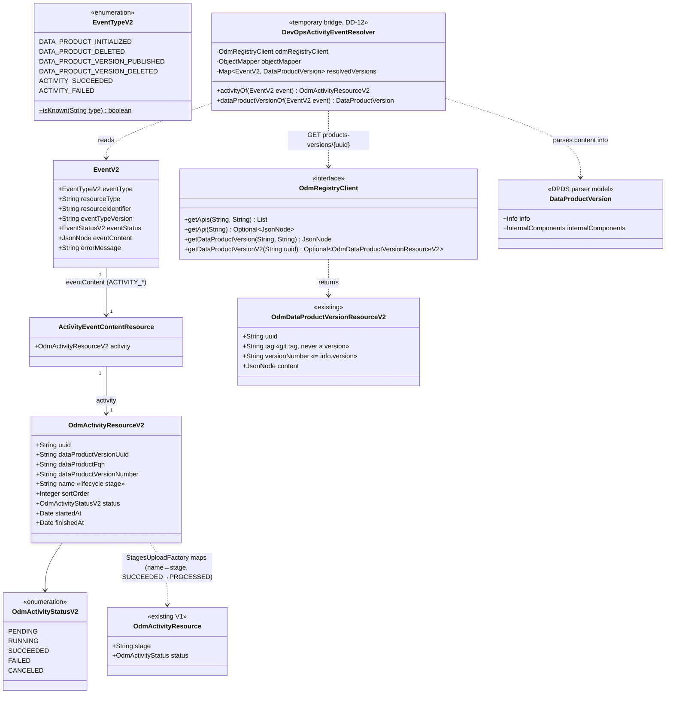

# DevOps 2.0 activity outcome events in the Blindata Observer

Source analysis: `spdd/analysis/BDMD-5558-202611031703-[Analysis]-devops-v2-events-handling.md` (revision 3). Decisions are cited by their analysis ids (DD-n, Q-n).

## Requirements

Let the Blindata Observer react to DevOps 2.0 activity outcomes (`ACTIVITY_SUCCEEDED`, `ACTIVITY_FAILED`) the way it reacted to DevOps V1 `DATA_PRODUCT_ACTIVITY_COMPLETED`. Blindata then keeps receiving stages, policy results and, where configured, the full data product upload when a platform moves to DevOps 2.0.

- **Reuse what exists.** The new events go through the existing V2 pipeline, the existing use cases, and the `blindata.eventHandlers` configuration. No new use case is added.
- **Close the payload gap temporarily.** DevOps 2.0 events carry no descriptor. The observer reads the data product version from Registry V2 through one isolated, documented bridge. It is removed once events are enriched upstream (DD-12).
- **Tolerate what it does not handle.** An unrecognised V2 event type is logged and closed as `PROCESSED`, and never breaks the queue (DD-7).
- **No regression.** The V1 path, the V1 DevOps types and the Registry V2 events keep their behaviour (DD-9).
- **Out of scope:**
  - changes to DevOps, Notification or Registry;
  - `ACTIVITY_CANCELED` and the six approval/request events, which are ignored (Q3);
  - event replay (BDMD-5521);
  - Policy V2 (BDMD-5444).

## Entities



## Approach

1. **Event vocabulary and subscription (DD-2, Q10).**
   - Add `ACTIVITY_SUCCEEDED` and `ACTIVITY_FAILED` to `EventTypeV2` and to the hardcoded `OdmObserverClientConfigs.eventTypesV2ToSubscribe`. They are subscribed as `BLINDATA-V2`, like the Registry V2 types.
   - `ACTIVITY_CANCELED` and the request/approve/reject events are neither added nor subscribed.

2. **Unrecognised events (DD-7, Q7).**
   - `NotificationEventConsumerServiceV2.processNotification` checks the incoming type before mapping it to `EventV2`.
   - For an unrecognised type it logs a warning, sets `PROCESSED`, runs no handler, and still writes the final status back to Notification (the existing `finally`).
   - The HTTP response stays `200 PROCESSING`. Unknown types are not processing errors: there is nothing to retry.

3. **Factories (DD-3, DD-4, DD-10, Q4).** The six factories that support V1 `DATA_PRODUCT_ACTIVITY_COMPLETED` get a V2 branch:

   | Factory (use case) | `ACTIVITY_SUCCEEDED` | `ACTIVITY_FAILED` | ODM port built from |
   |---|---|---|---|
   | `DataProductUploadFactory` (`DATA_PRODUCT_UPLOAD`) | yes | yes | resolved `DataProductVersion.getInfo()` |
   | `DataProductPortsAndAssetsUploadFactory` (`DATA_PRODUCT_VERSION_UPLOAD`) | yes | yes | resolved `DataProductVersion` |
   | `QualityUploadFactory` (`QUALITY_UPLOAD`) | yes | yes | resolved `DataProductVersion` |
   | `ProbesUploadFactory` (`PROBES_UPLOAD`) | yes | yes | resolved `DataProductVersion` |
   | `StagesUploadFactory` (`STAGES_UPLOAD`) | yes | **no** (V1 uploaded nothing on failure) | resolved `DataProductVersion` + the activity mapped to `OdmActivityResource` |
   | `PoliciesUploadFactory` (`POLICIES_UPLOAD`) | yes | yes | resolved `DataProductVersion.getInfo()` |

   - Each factory's `initOdmOutboundPortV2` gets `case ACTIVITY_SUCCEEDED` / `case ACTIVITY_FAILED`, which call the resolver. Use cases and port implementations do not change.
   - `StagesUploadFactory` maps the V2 activity to the existing V1 `OdmActivityResource`: `stage = name`, and `status = PROCESSED` for `SUCCEEDED` or `FAILED` otherwise. `StagesUploadOdmOutboundPortImpl` keeps its `PROCESSED` check as a safety net, unchanged (DD-3).

4. **Temporary Registry V2 bridge (DD-5, DD-12, Q6).**
   - A single `@Component`, `DevOpsActivityEventResolver`, is the only code that reads Registry V2 for DevOps events. Factories depend on it, and use cases and ports never see it.
   - It parses `eventContent.activity` and reads `GET /api/v2/pp/registry/products-versions/{dataProductVersionUuid}`.
   - It parses `content` (not `/resolve`) into `DataProductVersion`, the same way `DATA_PRODUCT_VERSION_PUBLISHED` branches do (`objectMapper.readValue(content.toString(), DataProductVersion.class)`).
   - **Memoised per event:** an identity-keyed `WeakHashMap<EventV2, DataProductVersion>`, synchronised, so one event with six active use cases makes one Registry call.
   - **Failures:** a 404, a disabled client, a client error or a malformed descriptor become `UseCaseInitException`, with a message naming Registry V2 and the version uuid. The existing `UseCasesExecutionTemplateV2` turns it into `FAILED_TO_PROCESS` with that message.
   - Javadoc on the resolver and on `OdmRegistryClient.getDataProductVersionV2` states that the read is temporary, why it exists (DevOps 2.0 events carry no descriptor), and what replaces it (events enriched upstream, likely by Notification).

5. **Registry client configuration (DD-5, Q6).**
   - Add `odm.productPlane.registryService.apiVersion` (default `v1`), read like `notificationService.apiVersion`.
   - `OdmRegistryClientConfigs` validates it at bean creation: `v1` and `v2` are accepted case-insensitively; anything else fails startup with a message naming the key.
   - The V1 methods keep their routes. `getDataProductVersionV2` works only with `active: true` and `apiVersion: v2`. Otherwise it throws `IllegalStateException` with a "Registry V2 not configured" message that names the keys to set:
     - the disabled stub when inactive;
     - `OdmRegistryClientImpl` when `apiVersion` is `v1`.

6. **Version identifiers (DD-11, Q5, Q8).**
   - The stage version and the policy lookup keep using the descriptor's `info.version`, which equals Registry `versionNumber`. Registry `tag` (the Git tag) is never read.
   - DevOps' `dataProductVersionNumber` maps directly onto `OdmActivityResourceV2.dataProductVersionNumber`. It is used only in log and error messages.

7. **Configuration and docs (DD-3, DD-6, DD-13, AC 1).**
   - **No packaged default for the new types.** `application.yml` ships only V1 defaults, and no Registry V2 type is packaged. `spdd/norms/CONFIGURATION.md` forbids new packaged collections. The default mapping for the new events is therefore a documented reference configuration in `docs/configuration/event-handling.md`, extending Example 4:
     - `ACTIVITY_SUCCEEDED` → `STAGES_UPLOAD` + `POLICIES_UPLOAD`;
     - `ACTIVITY_FAILED` → `POLICIES_UPLOAD`.
   - The docs add:
     - the DevOps 2.0 event → observer action table, with every DevOps event, including the "ignored" ones;
     - the V2 filter syntax (`#root['eventContent']['activity']['name'] == 'prod'`);
     - an environment-specific V2 example;
     - the Registry `apiVersion` requirement and the "temporary" note;
     - a Mermaid diagram of DevOps → Notification → observer → Registry → Blindata.
   - The "Supported V2 Event Types" column of the actions table gets the new types.
   - "Stage transition" / "activity started" are documented as having no DevOps 2.0 counterpart (DD-13).
   - Execution mode is not branched on anywhere (DD-8).
   - An activity name that is not a `lifecycleInfo` key is uploaded as-is, as V1 did.

## Structure

### Inheritance Relationships

1. `UseCaseFactory` (existing) declares `getUseCaseV2(EventV2)`. The six factories implement it and gain the two event types in `supportedEventTypesV2` (five factories for `ACTIVITY_FAILED`).
2. `OdmRegistryClient` (existing interface) gains `getDataProductVersionV2(String)`. `OdmRegistryClientImpl` and the disabled stub in `OdmRegistryClientConfigs` implement it.
3. `NotificationEventHandlerV2` / `UseCasesExecutionTemplateV2` are unchanged.
4. `UseCaseInitException extends RuntimeException` (existing) carries resolver failures.

### Dependencies

1. `OdmPlatformConsumeControllerV2Impl` → `NotificationEventConsumerServiceV2` (gains the unrecognised-type branch) → `NotificationEventManagerV2` → `UseCasesExecutionTemplateV2` → factories.
2. Six factories → `DevOpsActivityEventResolver` (new, injected with `@Autowired` like their other collaborators).
3. `DevOpsActivityEventResolver` → `OdmRegistryClient` and Spring's `ObjectMapper`.
4. `OdmRegistryClientConfigs` → `OdmRegistryClientImpl(restTemplate, address, apiVersion)`.
5. `OdmObserverClientConfigs` → `EventTypeV2` (two more subscribed values).
6. No dependency from any use case or `*OutboundPortImpl` to the resolver or the Registry client (DD-12).

### Layered Architecture

1. **Inbound HTTP** (`controllers/v2`): unchanged; always answers `200 PROCESSING`.
2. **Application** (`services/v2`): the queue consumer decides recognised vs unrecognised. The manager and template dispatch to the configured handlers.
3. **Event-to-port translation** (factories, plus `services/v2/devopsevents/DevOpsActivityEventResolver`): turns an `EventV2` into the domain input of each use case. This is the only layer that knows DevOps 2.0 events.
4. **Use cases and ports** (`services/usecases/*`): unchanged.
5. **Clients** (`client/odm`): `OdmRegistryClient` speaks Registry V2 for one read. Remote errors stay inside the client as `ClientException` and are wrapped by the resolver.
6. **Error handling:** `UseCaseInitException` / `UseCaseExecutionException` → `FAILED_TO_PROCESS` + message, in `UseCasesExecutionTemplateV2` (existing). Unrecognised types → `PROCESSED` in `NotificationEventConsumerServiceV2`.

## Operations

Execution order: 1 → 2 → 3 → 4 → 5 → 6 → 7 → 8 → 9 → 10 → 11.

### 1. Update Enum - `EventTypeV2`
1. Responsibility: the V2 event types the observer knows.
2. Changes:
   - Add `ACTIVITY_SUCCEEDED` and `ACTIVITY_FAILED`, after the Registry types, with a one-line comment "DevOps 2.0 activity outcomes (BDMD-5558)".
   - Add `public static boolean isKnown(String type)`. It returns true when `type` is non-null and equals the `name()` of a value (exact, case-sensitive, as `valueOf` is). It is implemented by streaming over `values()`; no exception is used for control flow.
3. Constraints: do not add `ACTIVITY_CANCELED` or the request/approve/reject types.

### 2. Create Resources - `ActivityEventContentResource`, `OdmActivityResourceV2`, `OdmActivityStatusV2`
1. Location:
   - `resources/odm/notification/v2/eventcontents/ActivityEventContentResource.java`, next to `DataProductVersionPublishedEventContentResource`;
   - `resources/odm/devops/v2/OdmActivityResourceV2.java` and `resources/odm/devops/v2/OdmActivityStatusV2.java`.
2. `ActivityEventContentResource`: field `OdmActivityResourceV2 activity`, a package-private no-arg constructor (as in `DataProductVersionPublishedEventContentResource`), and a getter and setter.
3. `OdmActivityResourceV2`: JavaBean with a public no-arg constructor. Fields:
   - `uuid: String`
   - `dataProductVersionUuid: String`
   - `dataProductFqn: String`
   - `dataProductVersionNumber: String`. Its Javadoc reads: "The descriptor `info.version` (Registry V2 `versionNumber`), not the Git tag."
   - `name: String`: the lifecycle stage.
   - `sortOrder: Integer`
   - `status: OdmActivityStatusV2`
   - `startedAt: Date`, `finishedAt: Date`
4. `tasks`, `executionMode` and any other DevOps fields are **not** modelled. Spring's `ObjectMapper` ignores unknown properties, so payload drift is tolerated.
5. `OdmActivityStatusV2`: `PENDING, RUNNING, SUCCEEDED, FAILED, CANCELED` (mirrors DevOps `ExecutionStatus`).

### 3. Update Client - `OdmRegistryClient`, `OdmRegistryClientImpl`, `OdmRegistryClientConfigs`
1. `OdmRegistryClient`: add `Optional<OdmDataProductVersionResourceV2> getDataProductVersionV2(String dataProductVersionUuid)`, with this Javadoc:
   - It reads one published data product version from Registry V2.
   - **TEMPORARY (BDMD-5558):** it exists only because DevOps 2.0 events carry no descriptor.
   - Remove it once the events are enriched upstream (likely by Notification).
2. `OdmRegistryClientImpl`:
   - The constructor becomes `OdmRegistryClientImpl(RestTemplate restTemplate, String baseUrl, String apiVersion)` and stores `apiVersion`.
   - `getDataProductVersionV2(uuid)`:
     - Throw `IllegalStateException("ODM Registry V2 is not configured: set odm.productPlane.registryService.apiVersion to v2 to read data product version " + uuid)` when `apiVersion` is not V2.
     - Otherwise call `restUtils.get(baseUrl + "/api/v2/pp/registry/products-versions/{uuid}", null, uuid, OdmDataProductVersionResourceV2.class)`.
     - Return `Optional.ofNullable(result)`.
     - Catch `ClientException` with `getCode() == 404` and return `Optional.empty()`. Let other `ClientException` / `ClientResourceMappingException` propagate.
   - Steps are private methods at the bottom: `requireV2(uuid)` and `isNotFound(ClientException)`.
3. `OdmRegistryClientConfigs`:
   - Add `@Value("${odm.productPlane.registryService.apiVersion:v1}") private String apiVersion`.
   - In `odmRegistryClient()`, call `validatedApiVersion()` first. It returns the upper-cased value, or throws `IllegalStateException("Unsupported odm.productPlane.registryService.apiVersion: '" + apiVersion + "'. Allowed values: v1, v2.")`.
   - Pass the value to `OdmRegistryClientImpl`.
   - The disabled stub implements `getDataProductVersionV2`: it logs a warning and throws `IllegalStateException("ODM Registry client is disabled (odm.productPlane.registryService.active=false): cannot read data product version " + uuid)`.
   - Existing V1 methods and log messages are unchanged.

### 4. Create Component - `DevOpsActivityEventResolver`
1. Location: `services/v2/devopsevents/DevOpsActivityEventResolver.java`. `@Component`, public.
2. Class Javadoc (mandatory, DD-12):
   - It turns a DevOps 2.0 activity event into the inputs the use-case factories need.
   - **TEMPORARY BRIDGE:** DevOps 2.0 events carry only the version identity, so the descriptor is read from Registry V2 by `dataProductVersionUuid`.
   - When the events are enriched upstream (likely by Notification), `dataProductVersionOf` reads the descriptor from the event and the Registry read is deleted.
   - Factories and use cases must not depend on the Registry client.
3. Collaborators: `OdmRegistryClient odmRegistryClient`, `ObjectMapper objectMapper` (constructor injection).
4. State: `private final Map<EventV2, DataProductVersion> resolvedVersions = Collections.synchronizedMap(new WeakHashMap<>())`. `EventV2` has no `equals`/`hashCode`, so keys are compared by identity: one entry per event instance, released when the event is collected.
5. Methods:
   - `public OdmActivityResourceV2 activityOf(EventV2 event)`:
     - Logic: `requireContent(event)` → `objectMapper.treeToValue(event.getEventContent(), ActivityEventContentResource.class)` → `requireActivity(content, event)`.
     - Errors: null content → `UseCaseInitException("Event content is null for event type: " + type)`. A missing `activity` or `dataProductVersionUuid` → `UseCaseInitException("Missing activity.dataProductVersionUuid in " + type + " event " + resourceIdentifier)`. A `JsonProcessingException` → `UseCaseInitException("Failed to parse " + type + " event content.", e)`.
   - `public DataProductVersion dataProductVersionOf(EventV2 event)`:
     - Logic: return the cached value if present. Otherwise `activityOf(event)` → `readFromRegistry(activity)` → `parseDescriptor(version, activity)`, then cache and return.
     - Use `get` then `put`, not `computeIfAbsent`: the lambda would have to throw checked-free `UseCaseInitException`, and failures must not be cached.
     - Logging: `info` "[DevOpsActivityEventResolver] Reading data product version {uuid} ({fqn} {dataProductVersionNumber}) from ODM Registry V2 for {type} of activity {name}".
   - `private OdmDataProductVersionResourceV2 readFromRegistry(OdmActivityResourceV2 activity)`:
     - Call `odmRegistryClient.getDataProductVersionV2(uuid)`.
     - Empty → `UseCaseInitException("Data product version " + uuid + " (" + fqn + " " + versionNumber + ") not found in ODM Registry V2.")`.
     - Any `RuntimeException` → `UseCaseInitException("Failed to read data product version " + uuid + " from ODM Registry V2.", e)`.
   - `private DataProductVersion parseDescriptor(OdmDataProductVersionResourceV2 version, OdmActivityResourceV2 activity)`:
     - `version.getContent()` null → `UseCaseInitException("ODM Registry V2 returned no content for data product version " + uuid)`.
     - Otherwise `objectMapper.readValue(version.getContent().toString(), DataProductVersion.class)`. A `JsonProcessingException` → `UseCaseInitException("Failed to parse descriptor of data product version " + uuid + ".", e)`.
     - Never read `version.getTag()`.
6. Constraints:
   - No branch on execution mode or event type: both outcome events resolve the same way.
   - No business decision; what to run is decided by configuration and factories.

### 5. Update Factories - V2 branches for activity outcomes
For each of the six factories:
1. Add `@Autowired private DevOpsActivityEventResolver devOpsActivityEventResolver;`.
2. Extend `supportedEventTypesV2`:
   - `ACTIVITY_SUCCEEDED` and `ACTIVITY_FAILED` in `DataProductUploadFactory`, `DataProductPortsAndAssetsUploadFactory`, `QualityUploadFactory`, `ProbesUploadFactory` and `PoliciesUploadFactory`;
   - `ACTIVITY_SUCCEEDED` only in `StagesUploadFactory`.
3. In `initOdmOutboundPortV2`, add the two activity cases to the existing switch. The existing `eventContent == null` guard stays and applies to them too; the resolver adds its own checks on the activity. Cases:
   - `DataProductUploadFactory`: `case ACTIVITY_SUCCEEDED, ACTIVITY_FAILED -> createOutboundPortFromDataProductVersion(resolver.dataProductVersionOf(event).getInfo() …)`. Reuse the existing null checks for `info` by adding a V2 overload of the private method that takes `EventTypeV2`, or by inlining the same `info == null` check. The message is "dataProductVersion.info is null in Registry V2 content for event type: " + type.
   - `DataProductPortsAndAssetsUploadFactory`: `new DataProductPortsAndAssetsUploadOdmOutboundPortImpl(dataProductPortAssetAnalyzer, resolver.dataProductVersionOf(event))`.
   - `QualityUploadFactory`: `new QualityUploadOdmOutboundPortImpl(dataProductPortAssetAnalyzer, resolver.dataProductVersionOf(event))`.
   - `ProbesUploadFactory`: `new ProbesUploadOdmOutboundPortImpl(dataProductPortAssetAnalyzer, resolver.dataProductVersionOf(event), probesUploadConfig)`.
   - `PoliciesUploadFactory`: `new PoliciesUploadOdmOutboundPortImpl(odmPolicyEvaluationResultClient, resolver.dataProductVersionOf(event).getInfo())`.
   - `StagesUploadFactory`, `case ACTIVITY_SUCCEEDED`: `new StagesUploadOdmOutboundPortImpl(resolver.dataProductVersionOf(event), toStageActivity(resolver.activityOf(event)))`.
4. `StagesUploadFactory` gets a private method at the bottom: `OdmActivityResource toStageActivity(OdmActivityResourceV2 activity)`. It sets `stage = activity.getName()` and `status = activity.getStatus() == SUCCEEDED ? OdmActivityStatus.PROCESSED : OdmActivityStatus.FAILED`.
5. Keep each `initOdmOutboundPortV2` a switch of named cases. The resolver call is the only new logic, and no parsing is duplicated in the factories.
6. Constraints:
   - V1 branches and dry-run methods are untouched.
   - `StagesUploadFactory.getUseCaseV2(ACTIVITY_FAILED)` keeps throwing the existing "unsupported event type" `UseCaseInitException`.

### 6. Update Subscription - `OdmObserverClientConfigs`
1. Add `EventTypeV2.ACTIVITY_SUCCEEDED` and `EventTypeV2.ACTIVITY_FAILED` to `eventTypesV2ToSubscribe`, with a comment "DevOps 2.0 activity outcomes; ACTIVITY_CANCELED and request/approval events are intentionally not subscribed (BDMD-5558)".
2. No other change; V1 DevOps types stay subscribed on the V1 observer (DD-9).

### 7. Update Consumer - `NotificationEventConsumerServiceV2`
1. Responsibility: the queue worker never throws on an unrecognised type, and always writes a final status.
2. `processNotification(notification)` becomes:
   ```text
   try {
     if (isUnrecognised(notification)) { ignore(notification); return; }
     EventV2 resolvedEvent = notificationEventManagerV2.notify(odmToInternalEvent(notification.getEvent()));
     …existing status/error mapping…
   } finally {
     updateEventNotificationOnNotificationService(notification);
   }
   ```
3. Private methods at the bottom:
   - `isUnrecognised(OdmEventNotificationResourceV2 n)`: returns `!EventTypeV2.isKnown(n.getEvent().getType())`.
   - `ignore(OdmEventNotificationResourceV2 n)`: `log.warn("Ignoring V2 notification {} of unrecognised event type '{}' (resource {} {}).", sequenceId, type, resourceType, resourceIdentifier)`, then `n.setStatus(OdmEventNotificationStatusV2.PROCESSED)`.
4. Constraints: the queue, the `@Async` worker, and the HTTP response are unchanged. A null `event` is treated as unrecognised (`isKnown(null)` is false); the log line must not NPE, so read the fields null-safely.

### 8. Update Configuration Docs
1. `docs/configuration/event-handling.md`:
   - **V2 event types list:** add `ACTIVITY_SUCCEEDED` and `ACTIVITY_FAILED`, emitted by DevOps 2.0.
   - **Actions table:** add the new types to "Supported V2 Event Types". For `STAGES_UPLOAD` add only `ACTIVITY_SUCCEEDED`, with a note that V1 also uploaded nothing on failure.
   - **New section "DevOps 2.0 events":**
     - the full DevOps 2.0 event → observer action table (AC 1): all nine DevOps events, with "ignored (not subscribed)" for `ACTIVITY_CANCELED` and the six request/approve/reject events;
     - the V1 → V2 mapping (`DATA_PRODUCT_ACTIVITY_COMPLETED` + `PROCESSED` → `ACTIVITY_SUCCEEDED`; + `FAILED` → `ACTIVITY_FAILED`; `ABORTED` → `ACTIVITY_CANCELED`, ignored);
     - a note that there is no "activity started"/"stage transition" counterpart;
     - a note that execution mode (Full Control / Instrumented) does not change the events;
     - the V2 filter syntax `#root['eventContent']['activity']['name']`, replacing V1 `#root['afterState']['activity']['stage']`;
     - a Mermaid flowchart DevOps 2.0 → Notification V2 → `BLINDATA-V2` → factories → Registry V2 (temporary) → Blindata.
   - **Registry requirement**, stated in the same section: DevOps events need `registryService.active: true` and `apiVersion: v2`. Otherwise the notification ends `FAILED_TO_PROCESS` with a "not configured" message. The Registry read is temporary until events are enriched upstream.
   - **Example 4:** extend with the two reference handlers (`ACTIVITY_SUCCEEDED` → `STAGES_UPLOAD`, `POLICIES_UPLOAD`; `ACTIVITY_FAILED` → `POLICIES_UPLOAD`).
   - **New Example 5,** "DevOps 2.0 environment-specific": `dev` → stages + policies; `prod` → the full upload on `ACTIVITY_SUCCEEDED` and everything except stages on `ACTIVITY_FAILED`.
2. `docs/configuration/odm-platform-configurations.md`: add `apiVersion` to the Registry YAML snippet and the table: `string`, default `v1`, `v1` / `v2`, required `v2` for DevOps 2.0 events, temporary.
3. `README.md`: the existing Event Handling link also mentions DevOps 2.0 events.

### 9. Update Test Configuration - `src/test/resources/application-test.yml`
Add these handlers (shared by all ITs, so there are no per-class overrides):
```yaml
    - eventType: ACTIVITY_SUCCEEDED
      filter: ""
      activeUseCases: [STAGES_UPLOAD, POLICIES_UPLOAD]
    - eventType: ACTIVITY_SUCCEEDED
      filter: "#root['eventContent']['activity']['name'] == 'prod'"
      activeUseCases: [DATA_PRODUCT_UPLOAD, DATA_PRODUCT_VERSION_UPLOAD, QUALITY_UPLOAD, PROBES_UPLOAD]
    - eventType: ACTIVITY_FAILED
      filter: ""
      activeUseCases: [POLICIES_UPLOAD]
    - eventType: ACTIVITY_FAILED
      filter: "#root['eventContent']['activity']['name'] == 'prod'"
      activeUseCases: [DATA_PRODUCT_UPLOAD, DATA_PRODUCT_VERSION_UPLOAD, QUALITY_UPLOAD, PROBES_UPLOAD]
```
Existing tests are unaffected, because no existing fixture uses these types.

### 10. Create Test Fixtures - `src/test/resources/.../rest/v2/`
- `activitySucceeded_dev_eventNotification.json`:
  - `type: ACTIVITY_SUCCEEDED`, `resourceType: ACTIVITY`, `eventTypeVersion: V2.0.0`;
  - activity `name: dev`, `status: SUCCEEDED`, `dataProductVersionUuid: dpv-uuid-1`, `dataProductVersionNumber: 1.0.0`;
  - two tasks, one `FULL_CONTROL` and one `INSTRUMENTED` (`executionMode`), plus an unknown extra field to prove tolerance.
- `activitySucceeded_instrumented_eventNotification.json`: as above, with only `INSTRUMENTED` tasks.
- `activitySucceeded_prod_eventNotification.json`, `activityFailed_dev_eventNotification.json`, `activityFailed_prod_eventNotification.json`.
- `activityCanceled_eventNotification.json` and `unknownType_eventNotification.json` (`type: SOMETHING_NEW`).
- `registry_dataProductVersion_dpv-uuid-1.json`: an `OdmDataProductVersionResourceV2` with `versionNumber: 1.0.0` and **`tag: v1.0.0-release`** (deliberately different). Its `content` is a minimal descriptor: `info.id`, `info.fullyQualifiedName`, `info.version: 1.0.0`, and `internalComponents.lifecycleInfo` with `dev` and `prod`.

### 11. Implement Tests

#### High-level tests (Gherkin)

```gherkin
Feature: DevOps 2.0 activity succeeded

  Scenario: A successful activity uploads its stage and the policy results
    Given the data product exists on Blindata
    And Registry V2 holds the data product version with version number "1.0.0" and git tag "v1.0.0-release"
    When the observer receives ACTIVITY_SUCCEEDED for the activity "dev" of that version
    Then the stage "dev" with version "1.0.0" is uploaded to Blindata
    And the policy evaluation results are searched by the descriptor id and version "1.0.0"
    And the notification is closed as PROCESSED

  Scenario: The version is read from Registry once per event, whatever the number of use cases
    Given the data product exists on Blindata
    And the handlers for the stage "prod" run six use cases on ACTIVITY_SUCCEEDED
    When the observer receives ACTIVITY_SUCCEEDED for the activity "prod"
    Then the data product, its ports, quality, probes, stage and policies are uploaded
    And Registry V2 is called exactly once for that event
    And the notification is closed as PROCESSED

  Scenario: The execution mode does not change what the observer does
    Given the data product exists on Blindata
    When the observer receives ACTIVITY_SUCCEEDED for an activity whose tasks are all instrumented
    Then the stage and the policy results are uploaded as for a full-control activity

Feature: DevOps 2.0 activity failed

  Scenario: A failed activity uploads the policy results and no stage
    Given the data product exists on Blindata
    When the observer receives ACTIVITY_FAILED for the activity "dev"
    Then the policy evaluation results are uploaded to Blindata
    And no stage is uploaded
    And the notification is closed as PROCESSED

  Scenario: A failed production activity runs the full upload except stages
    Given the data product exists on Blindata
    When the observer receives ACTIVITY_FAILED for the activity "prod"
    Then the data product, its ports, quality, probes and policies are uploaded
    And no stage is uploaded

  Scenario: Stages cannot be configured on a failed activity
    Given STAGES_UPLOAD is asked to build a use case
    When the event is ACTIVITY_FAILED
    Then the factory refuses it as an unsupported event type

Feature: Temporary Registry V2 bridge

  Scenario: The version is missing from Registry V2
    Given Registry V2 does not know the data product version of the activity
    When the observer receives ACTIVITY_SUCCEEDED for that activity
    Then nothing is uploaded to Blindata
    And the notification is closed as FAILED_TO_PROCESS with a message naming Registry V2 and the version uuid

  Scenario: The data product is not on Blindata yet
    Given the data product does not exist on Blindata
    When the observer receives ACTIVITY_SUCCEEDED
    Then nothing is uploaded to Blindata
    And the notification is closed as PROCESSED

  Scenario: A resolved version is reused within the same event
    Given the resolver has already read the version for an event
    When a second use case asks for the same event's version
    Then Registry V2 is not called again

  Scenario: The Registry client is disabled
    Given the Registry client is not active
    When a DevOps activity version is read
    Then the read fails with a message saying the Registry is disabled

  Scenario: The Registry client is on API v1
    Given the Registry client is active with apiVersion v1
    When a DevOps activity version is read
    Then the read fails with a message saying Registry V2 is not configured

  Scenario: An invalid Registry apiVersion stops the service
    Given odm.productPlane.registryService.apiVersion is "v3"
    When the Registry client is created
    Then creation fails with a message naming the key and the allowed values

Feature: Events the observer does not handle

  Scenario: A canceled activity is ignored
    When the observer receives ACTIVITY_CANCELED
    Then the response is 200 PROCESSING
    And neither Registry V2 nor Blindata is called
    And the notification is closed as PROCESSED

  Scenario: An unknown event type is ignored
    When the observer receives an event of type SOMETHING_NEW
    Then the response is 200 PROCESSING
    And neither Registry V2 nor Blindata is called
    And the notification is closed as PROCESSED

Feature: No regression on Registry V2 events

  Scenario: A published version is still processed from the event content
    When the observer receives DATA_PRODUCT_VERSION_PUBLISHED
    Then its use cases run from the descriptor in the event
    And Registry V2 is not called
```

| Feature / Scenario | Test class | Method |
| --- | --- | --- |
| Activity succeeded / A successful activity uploads its stage and the policy results | `DevOpsActivityEventsV2IT` | `whenActivitySucceededThenStageAndPoliciesAreUploaded` |
| Activity succeeded / The version is read from Registry once per event, whatever the number of use cases | `DevOpsActivityEventsV2IT` | `whenProdActivitySucceededThenFullUploadWithSingleRegistryRead` |
| Activity succeeded / The execution mode does not change what the observer does | `DevOpsActivityEventsV2IT` | `whenInstrumentedActivitySucceededThenSameOutcomeAsFullControl` |
| Activity failed / A failed activity uploads the policy results and no stage | `DevOpsActivityEventsV2IT` | `whenActivityFailedThenPoliciesUploadedAndNoStage` |
| Activity failed / A failed production activity runs the full upload except stages | `DevOpsActivityEventsV2IT` | `whenProdActivityFailedThenFullUploadWithoutStages` |
| Activity failed / Stages cannot be configured on a failed activity | `StagesUploadFactoryTest` | `whenActivityFailedThenUnsupportedEventType` |
| Registry bridge / The version is missing from Registry V2 | `DevOpsActivityEventsV2IT` | `whenVersionMissingInRegistryThenFailedToProcess` |
| Registry bridge / The data product is not on Blindata yet | `DevOpsActivityEventsV2IT` | `whenDataProductNotOnBlindataThenProcessedWithoutUpload` |
| Registry bridge / A resolved version is reused within the same event | `DevOpsActivityEventResolverTest` | `whenSameEventResolvedTwiceThenRegistryCalledOnce` |
| Registry bridge / The Registry client is disabled | `OdmRegistryClientConfigsTest` | `whenRegistryInactiveThenV2ReadFailsAsDisabled` |
| Registry bridge / The Registry client is on API v1 | `OdmRegistryClientConfigsTest` | `whenApiVersionV1ThenV2ReadFailsAsNotConfigured` |
| Registry bridge / An invalid Registry apiVersion stops the service | `OdmRegistryClientConfigsTest` | `whenApiVersionInvalidThenCreationFails` |
| Unhandled events / A canceled activity is ignored | `DevOpsActivityEventsV2IT` | `whenActivityCanceledThenIgnoredAndProcessed` |
| Unhandled events / An unknown event type is ignored | `DevOpsActivityEventsV2IT` | `whenUnknownEventTypeThenIgnoredAndProcessed` |
| No regression / A published version is still processed from the event content | `DevOpsActivityEventsV2IT` | `whenVersionPublishedThenRegistryNotCalled` |

#### Test implementation tasks
1. **`rest/v2/DevOpsActivityEventsV2IT extends ObserverBlindataAppIT`.** It references BDMD-5558 in the class Javadoc, and each method's Javadoc copies its Gherkin scenario verbatim.
   - **Setup:**
     - autowire the mocked `OdmRegistryClient`, `OdmEventNotificationClient`, `BdDataProductClient`, `OdmPolicyEvaluationResultClient`, `BdPolicyEvaluationResultClient` and the clients used by the quality and probes uploads;
     - `Mockito.reset` them in `@BeforeEach`;
     - stub `bdDataProductClient.getDataProduct(any())` with an existing product;
     - stub `odmRegistryClient.getDataProductVersionV2("dpv-uuid-1")` from the Registry fixture;
     - stub `getPolicyEvaluationResults` with an empty page.
   - **Final status:** capture `updateEventNotificationV2(eq(sequenceId), captor)` and assert `status` / `errorMessage`. `TestConfig` makes `@Async` synchronous.
   - **Stage assertion:** capture `bdDataProductClient.uploadStages(...)` and assert exactly one stage, `name = dev` and `version = 1.0.0`, which is the `versionNumber`, not the tag.
   - **Policy assertion:** capture the `OdmPolicyEvaluationResultSearchOptions` and assert `dataProductId = info.id` and `dataProductVersion = 1.0.0`.
   - **Prod scenario:** stub the Blindata clients the four extra use cases need, so that they complete. Assert `PROCESSED` and `verify(odmRegistryClient, times(1)).getDataProductVersionV2("dpv-uuid-1")`.
   - **Regression scenario:** add `dataProductVersionPublished_eventNotification.json` and assert `verify(odmRegistryClient, never()).getDataProductVersionV2(any())`.
2. **`services/v2/devopsevents/DevOpsActivityEventResolverTest`** (plain JUnit + Mockito, real `ObjectMapper`). Cover:
   - memoisation per event instance: same event twice → one call; two event instances → two calls;
   - 404 (`Optional.empty()`) → `UseCaseInitException` message containing "not found in ODM Registry V2" and the uuid;
   - client `RuntimeException` → `UseCaseInitException` with "Failed to read data product version";
   - null content in the Registry response → `UseCaseInitException`;
   - missing `activity` / `dataProductVersionUuid` → `UseCaseInitException`;
   - the `dataProductVersionNumber` JSON field is parsed;
   - the parsed `info.version` equals `versionNumber` when the `tag` differs;
   - a failure is not cached: a second call after a failure calls Registry again.
3. **`client/odm/OdmRegistryClientConfigsTest`** (plain JUnit): set `active`, `address` and `apiVersion` with `ReflectionTestUtils.setField`, and use a `RestTemplateBuilder`. Cover the three Registry configuration scenarios, plus "v2 accepted case-insensitively".
4. **`services/usecases/stages_upload/StagesUploadFactoryTest`** (plain JUnit + Mockito, with the resolver mocked via `ReflectionTestUtils`). Cover:
   - `ACTIVITY_FAILED` → `UseCaseInitException` "unsupported event type";
   - `ACTIVITY_SUCCEEDED` → a use case is built, and `toStageActivity` maps `name → stage`, `SUCCEEDED → PROCESSED`.
5. Run `mvn verify`. All existing `rest/v1` and `rest/v2` ITs must stay green (AC 3).

## Norms

Norms read for this canvas: `spdd/norms/README.md` (registry), plus the derived files [`CODE_STRUCTURE.md`](../norms/CODE_STRUCTURE.md), [`PACKAGE_STRUCTURE.md`](../norms/PACKAGE_STRUCTURE.md), [`TESTING.md`](../norms/TESTING.md), [`INTEGRATIONS.md`](../norms/INTEGRATIONS.md), [`CONFIGURATION.md`](../norms/CONFIGURATION.md), [`ASYNC_EXECUTION.md`](../norms/ASYNC_EXECUTION.md), [`USE_CASE_IMPLEMENTATION.md`](../norms/USE_CASE_IMPLEMENTATION.md), [`PROGRESSIVE_DISCOVERY.md`](../norms/PROGRESSIVE_DISCOVERY.md) and [`API_DESIGN.md`](../norms/API_DESIGN.md). `GENERIC-CRUD-GUIDELINES.md` is skipped: module `persistence` is not in `template.yaml`.

1. **Annotation standards:**
   - `DevOpsActivityEventResolver` is a `@Component`. Factories stay `@Component`s, and port implementations stay plain classes (`USE_CASE_IMPLEMENTATION.md` §7–8).
   - New resources are plain JavaBeans, with no `@JsonProperty`.
2. **Dependency injection:**
   - The new component uses constructor injection.
   - Factories receive it with `@Autowired` fields, matching their existing collaborators. Do not convert the existing factories to constructor injection in this story.
3. **Exception handling:**
   - Factory-time failures, including every resolver failure, are `UseCaseInitException` with a descriptive message naming the remote system and the identifier, never headers or tokens (README "One error model").
   - Remote errors are caught at the client or resolver boundary and never passed through as raw transport exceptions (`INTEGRATIONS.md`).
   - The existing legacy use cases (throwing `UseCaseExecutionException`, no presenter) are not touched, so they are not migrated to the presenter model (`CODE_STRUCTURE.md`: "do not retrofit unrelated legacy files").
4. **Code structure:**
   - Every new or touched public method is a short outline of named steps; helpers are private methods at the bottom of the owner class.
   - No new `*Utils` / `*Helper` (`CODE_STRUCTURE.md`).
   - The resolver is a single small unit with no step classes, so no L0 README is required (`PROGRESSIVE_DISCOVERY.md`, "small units collapse levels").
5. **Package placement:** follow the existing service layout (`resources/odm/...`, `client/odm`, `services/v2/...`, `services/usecases/<verb>`). The service predates the canonical aggregate tree; new types go next to their existing peers rather than introducing a new top-level layout (`PACKAGE_STRUCTURE.md` applies to new modules).
6. **Integrations:**
   - Registry access stays in `OdmRegistryClient`, the one client per external system.
   - The new method returns the existing Registry V2 resource. The resolver is the anti-corruption point that turns it into the domain `DataProductVersion`, and no Registry type reaches a use case.
   - There is no retry: the read is idempotent, but a failure is surfaced as `FAILED_TO_PROCESS` for Notification replay (BDMD-5521) to handle.
7. **Configuration:**
   - `apiVersion` is validated at startup with a message naming the key.
   - The default `v1` is safe.
   - No new packaged collection: the event-handler mapping for the new types is documented, not added to `application.yml` (`CONFIGURATION.md`, "No packaged collections").
8. **Async:** no new executor or thread. The existing `@Async` queue worker is reused, and the resolver's memo is not a `ThreadLocal` (`ASYNC_EXECUTION.md`).
9. **Logging:**
   - `info` when the resolver reads Registry, with the version uuid, fqn, version number and activity name;
   - `warn` for an ignored unrecognised type, with the sequence id, type and resource;
   - never log full payloads or descriptors.
10. **Testing:**
    - `*IT` for the running application through `POST /api/v2/up/observer/notifications`; `*Test` for the resolver, client config and factory.
    - Integration tests use the shared `TestConfig` mocks and the shared `application-test.yml`: no `@MockBean`, `@DirtiesContext` or per-class properties.
    - Each Gherkin scenario maps to one test method whose Javadoc quotes it (`TESTING.md`).
11. **Documentation:** the "temporary bridge" Javadoc on the resolver and on `OdmRegistryClient.getDataProductVersionV2` is mandatory (DD-12). User-facing behaviour goes in `docs/configuration/*.md`.

## Safeguards

1. **Functional constraints:**
   - Only `ACTIVITY_SUCCEEDED` and `ACTIVITY_FAILED` are added to `EventTypeV2` and to the V2 subscription. `ACTIVITY_CANCELED`, `ACTIVITY_EXECUTION_*` and `ACTIVITY_TASK_EXECUTION_*` are not.
   - `STAGES_UPLOAD` supports `ACTIVITY_SUCCEEDED` only. The other five activity-capable use cases support both types.
   - On `ACTIVITY_SUCCEEDED`, exactly one stage is uploaded: `name` = activity `name`, `version` = descriptor `info.version`.
2. **Performance constraints:**
   - At most one Registry V2 call per DevOps event, whatever the number of matching handlers and use cases. A failed read is not cached.
   - An ignored or unknown event makes zero Registry and zero Blindata calls.
3. **Security constraints:**
   - Error messages and logs contain identifiers (uuid, fqn, version number, activity name), never headers, credentials or full descriptors.
   - The Registry client uses its own existing configuration; no credentials are forwarded from the inbound notification.
4. **Integration constraints:**
   - Registry V2 is read only through `GET /api/v2/pp/registry/products-versions/{uuid}`, using `content`, not `/resolve`.
   - Existing V1 Registry routes (`getApis`, `getApi`, `getDataProductVersion`) keep their URLs and behaviour for both `apiVersion` values.
   - DevOps payload fields not modelled (`tasks`, `executionMode`, …) must not break deserialization.
5. **Business rule constraints:**
   - Registry `tag` is never used as a version anywhere.
   - The Policy results lookup stays on `info.id` + `info.version` (DD-11).
   - No code branches on execution mode (DD-8).
   - Handler configuration remains the only switch deciding which use cases run on which stage.
   - An activity name not present in `lifecycleInfo` is uploaded unchanged, as in V1.
6. **Exception handling constraints:**
   - The following end `FAILED_TO_PROCESS` with a message naming Registry V2 or the parsing step and the version uuid:
     - Registry disabled, Registry not on v2, version not found;
     - a remote error;
     - malformed event content or descriptor.
   - An unrecognised V2 type never escapes `processNotification`. It ends `PROCESSED`, and the final status is always written back to Notification.
   - The HTTP response of the V2 consume endpoint is unchanged: always 200 with `PROCESSING` (AC 4).
7. **Technical constraints:**
   - Do not add `equals`/`hashCode` to `EventV2`: the resolver's memo relies on identity.
   - Do not move the Registry read into `NotificationEventManagerV2` or the template, which would enrich every event even when no handler matches.
   - Do not let any use case or `*OutboundPortImpl` import `OdmRegistryClient` or `DevOpsActivityEventResolver`. The removal of the bridge must touch only the resolver, the client method, its configuration and the docs (DD-12).
   - V1 consume path, V1 event types and dry-run paths are untouched (DD-9).
8. **Data constraints:**
   - `dataProductVersionUuid` is required in the event's `activity`; when it is absent, the event fails with a clear message.
   - The resolved `DataProductVersion.info` must be non-null for `DATA_PRODUCT_UPLOAD` and `POLICIES_UPLOAD`; the existing null-check style applies.
9. **API constraints:**
   - No change to the observer's public endpoints or OpenAPI.
   - The new configuration key `odm.productPlane.registryService.apiVersion` accepts `v1` | `v2` (case-insensitive) with default `v1`, and is documented in `odm-platform-configurations.md`.
10. **Verification outside CI (AC 5):** the end-to-end check runs on dev with DevOps 2.0 in Full Control and Instrumented (CLI, BDMD-5443). It also confirms on Blindata that uploading one stage per activity does not remove the version's other stages; this behaviour is unchanged from V1.
