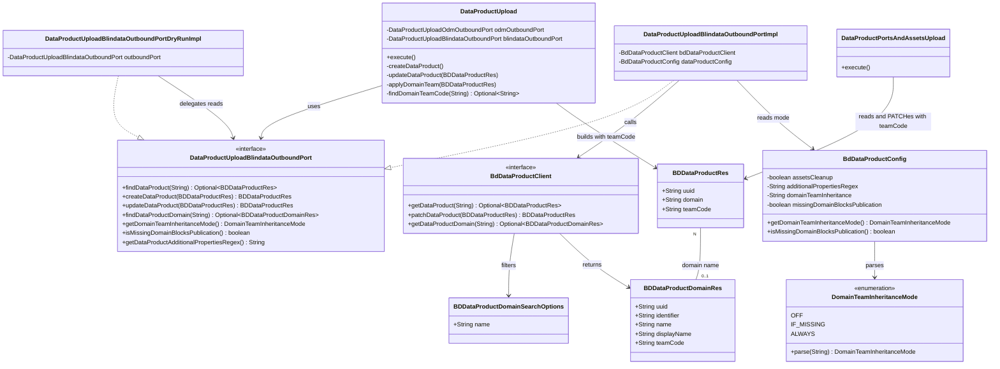

# Data Product Domain Team Inheritance in the Blindata Observer

## Requirements
Make the observer keep a Blindata data product's team across every upload, and optionally inherit it from the registered Data Product Domain. Data products published through ODM can then follow their domain's team-based ACL without any change to the Blindata API.

- Preserve the team stored in Blindata on every observer update: `DATA_PRODUCT_UPLOAD` and both PATCHes of `DATA_PRODUCT_VERSION_UPLOAD`. Today every update clears it.
- Look up the registered domain by the exact name in `info.domain` and apply its team according to `blindata.dataProducts.domainTeamInheritance`:
  - `OFF` (default): no lookup.
  - `IF_MISSING`: apply on create, and on update when the stored team is empty.
  - `ALWAYS`: apply on every upload.
- Never clear a team. A domain that is not found or has no team leaves the data product's team unchanged.
- Make blocking on a missing domain configurable with `blindata.dataProducts.missingDomainBlocksPublication` (default `false`). When `true`, a domain that cannot be found is a validator warning that blocks publication. When `false`, it is an info log.
- Out of scope: UI (blindata-ui), other parent → child pairs, any Blindata API change, migration of existing data products.

## Entities

## Approach
1. Team preservation (bug fix, every mode):
   - Add `teamCode` to `BDDataProductRes`. Blindata's data product response already carries `teamCode`, and the observer's ObjectMapper ignores unknown properties, so today the team is dropped on read and missing from every PATCH. Blindata's PATCH stores an omitted team as null.
   - `DataProductPortsAndAssetsUpload` reads the data product and PATCHes the same object twice. With the field in place, the team round-trips with no change to that use case.
   - The `DataProductUpload` update path rebuilds the data product from the descriptor. It copies the stored `teamCode` from the existing data product, as it already copies `uuid` and `version`.

2. Domain lookup:
   - New `BdDataProductClient.getDataProductDomain(String name)`: `GET {blindataUrl}/api/v1/dataproductsdomains?name=<name>`, page size 1, following `getDataProduct(identifier)` and `getLogicalNamespaceByIdentifier`.
   - Blindata's `name` filter is an exact match and returns only domains readable by the caller. The client still post-filters `name.equals(...)` as a guard.
   - It is exposed through `DataProductUploadBlindataOutboundPort.findDataProductDomain`. The dry-run port delegates it, so the validator runs the real lookup.

3. Mode handling in `DataProductUpload`:
   - A single step, `applyDomainTeam`, runs after the descriptor is mapped (and, on update, after the stored team is copied) and before the write:
     - `OFF` → return.
     - `IF_MISSING` and the data product already has a team → return, with no lookup.
     - Blank domain → return; `[#83]` already warns about it.
     - Otherwise look up the domain:
       - not found → team unchanged; `[#206]` warn when `missingDomainBlocksPublication` is `true`, info with the same message otherwise;
       - found without a team → info, team unchanged;
       - found with a team → set `teamCode`, info log.
   - The step never sets `teamCode` to null or empty.

4. Configuration:
   - `blindata.dataProducts.domainTeamInheritance` is read as a String in `BdDataProductConfig` (default `OFF`) and parsed once with `DomainTeamInheritanceMode.parse`.
   - Parsing trims the value, ignores case and maps `-` to `_`. `false`/`FALSE` maps to `OFF`, because YAML 1.1 reads unquoted `off` as a boolean.
   - An unknown value throws `IllegalStateException` at startup (`@PostConstruct`), naming the property and the accepted values.
   - Exposed to the use case through `DataProductUploadBlindataOutboundPort.getDomainTeamInheritanceMode()`.
   - `blindata.dataProducts.missingDomainBlocksPublication` is a boolean `@Value` with default `false`, exposed through `DataProductUploadBlindataOutboundPort.isMissingDomainBlocksPublication()`. It is read only when the mode is not `OFF` and the domain is not found.

5. Error handling and logging:
   - No new exception types. Blindata errors keep flowing through the existing `withErrorHandling`:
     - 403 on create or update (the technical user lacks WRITE on the team) → `[#84]` warn;
     - 500 → rethrown.
   - The new warning is `[#206] [DataProductUpload] ...`, emitted only when `missingDomainBlocksPublication` is `true`. Every use-case warning fails the validator policy evaluation, so `true` blocks publication of a data product whose domain cannot be found. With the default `false`, the same message is logged as info and never blocks.
   - Info logs for team applied, team kept and team-less domain.

6. Operations and documentation:
   - Document the two new properties, the YAML quoting, the team mapping row, `[#206]` and when it blocks, and that with a non-OFF mode the technical user needs READ and WRITE on all domain teams. With `ALWAYS`, it also needs WRITE on the team being replaced.
   - Release note: with the default `OFF`, the observer stops clearing data product teams on update.

## Structure

### Inheritance Relationships
1. `UseCase` interface defines `execute()`; package-private `DataProductUpload` and `DataProductPortsAndAssetsUpload` implement it.
2. `DataProductUploadBlindataOutboundPort` interface defines Blindata reads and writes for the data product upload.
3. `DataProductUploadBlindataOutboundPortImpl` implements it as the live adapter (plain Java, built with `new` by the factory).
4. `DataProductUploadBlindataOutboundPortDryRunImpl` implements it as the dry-run decorator: it delegates reads (now including the domain lookup and the mode) and stubs writes.
5. `BdClientImpl` implements `BdDataProductClient`, which gains `getDataProductDomain`.
6. `DomainTeamInheritanceMode` is a plain enum in `configurations`.

### Dependencies
1. `DataProductUpload` calls `DataProductUploadBlindataOutboundPort` for the data product read and write, the domain lookup and the mode.
2. `DataProductUploadBlindataOutboundPortImpl` depends on `BdDataProductClient` (existing bean), `BdDataProductConfig`, `BdUserClient` and `BdStewardshipClient` (unchanged constructor).
3. `DataProductUploadFactory` (`@Component`) builds the live port and wraps it with the dry-run port for `getUseCaseDryRun`. Its wiring is unchanged.
4. `BdClientConfigs` keeps the existing `bdDataProductClient` bean; no new bean.
5. `DataProductPortsAndAssetsUploadBlindataOutboundPortImpl` keeps calling `getDataProduct` and `patchDataProduct`; the team now round-trips through `BDDataProductRes`.

### Layered Architecture
1. Event and validator layer: `UseCasesExecutionTemplate` runs `DATA_PRODUCT_UPLOAD` and then `DATA_PRODUCT_VERSION_UPLOAD` sequentially; `BlindataValidatorService` runs their dry-runs.
2. Use case layer: `DataProductUpload` owns preservation, the mode decision and the domain lookup step.
3. Outbound port layer: `DataProductUploadBlindataOutboundPort` with its live and dry-run implementations.
4. Client layer: `BdDataProductClient` / `BdClientImpl` HTTP calls to `/api/v1/dataproducts` and `/api/v1/dataproductsdomains`.
5. Configuration layer: `BdDataProductConfig` (mode and missing-domain blocking) and `DomainTeamInheritanceMode`.
6. Exception and logging layer: `UseCaseLoggerContext` warnings, `[#NNN]` tags and `withErrorHandling`. No `GlobalExceptionHandler`, because the observer exposes no new REST surface.

## Operations

### Update Resource - BDDataProductRes
1. Responsibility: carry the Blindata data product team on read and write.
2. Attributes:
   - `teamCode`: String - Blindata team code; null means public.
3. Methods: `getTeamCode(): String`, `setTeamCode(String teamCode): void`, placed with the other getters and setters.
4. Constraints: no Jackson annotations (the field name matches Blindata's `teamCode`). `addOldAdditionalProperties` is unchanged.

### Create Resource - BDDataProductDomainRes
1. Responsibility: the observer's view of a Blindata Data Product Domain.
2. Package: `resources.blindata.product`.
3. Attributes: `uuid`, `identifier`, `name`, `displayName`, `description`, `teamCode` (all String), with getters and setters. No `additionalProperties`; unknown fields are ignored by the ObjectMapper.

### Create Resource - BDDataProductDomainSearchOptions
1. Responsibility: query filters for `GET /api/v1/dataproductsdomains`.
2. Package: `resources.blindata.product`.
3. Attributes: `name`: String - exact domain name (Blindata `DataProductsDomainsSearchOptions.name`). Getter and setter only, following `BDDataProductSearchOptions`.

### Extend Client - BdDataProductClient / BdClientImpl
1. Interface method: `Optional<BDDataProductDomainRes> getDataProductDomain(String name) throws BlindataClientException, BlindataClientResourceMappingException`.
2. Implementation in `BdClientImpl`, placed after `getDataProduct(String identifier)`:
   - Logic:
     1. Build `BDDataProductDomainSearchOptions` with `name`.
     2. `restUtils.getPage(String.format("%s/api/v1/dataproductsdomains", credentials.getBlindataUrl()), null, PageRequest.ofSize(1), filters, BDDataProductDomainRes.class)`.
     3. `.stream().filter(domain -> name.equals(domain.getName())).findFirst()`.
   - Exception handling: `ClientException` → `BlindataClientException(e.getCode(), e.getResponseBody())`; `ClientResourceMappingException` → `BlindataClientResourceMappingException(e.getMessage(), e)`, the same as `getDataProduct`.
3. Constraints: always uses `restUtils` (synchronous read), never `asyncRestUtils`. No new bean in `BdClientConfigs`.

### Create Enum - DomainTeamInheritanceMode
1. Package: `configurations`.
2. Values: `OFF`, `IF_MISSING`, `ALWAYS`.
3. Method: `static DomainTeamInheritanceMode parse(String value)`
   - Logic:
     1. Blank or null → `OFF`.
     2. Normalize with `value.trim().toUpperCase(Locale.ROOT).replace('-', '_')`.
     3. `"FALSE"` → `OFF`.
     4. Match against `values()` by name; otherwise throw `IllegalArgumentException("Invalid value '<value>' for blindata.dataProducts.domainTeamInheritance. Accepted values: OFF, IF_MISSING, ALWAYS")`.

### Update Configuration - BdDataProductConfig
1. Attributes:
   - `@Value("${blindata.dataProducts.domainTeamInheritance:OFF}") private String domainTeamInheritance;` and a private `DomainTeamInheritanceMode domainTeamInheritanceMode`.
   - `@Value("${blindata.dataProducts.missingDomainBlocksPublication:false}") private boolean missingDomainBlocksPublication;`
2. Methods:
   - `@PostConstruct void parseDomainTeamInheritance()`: sets `domainTeamInheritanceMode = DomainTeamInheritanceMode.parse(domainTeamInheritance)`. It rethrows `IllegalArgumentException` as `IllegalStateException` with the same message, so startup fails visibly.
   - `getDomainTeamInheritanceMode(): DomainTeamInheritanceMode`.
   - `isMissingDomainBlocksPublication(): boolean`, named like the existing `isAssetsCleanup()`.
3. Constraints: existing `assetsCleanup` and `additionalPropertiesRegex` are unchanged.

### Update Outbound Port - DataProductUploadBlindataOutboundPort (+ Impl + DryRunImpl)
1. New methods:
   - `Optional<BDDataProductDomainRes> findDataProductDomain(String domainName)`
   - `DomainTeamInheritanceMode getDomainTeamInheritanceMode()`
   - `boolean isMissingDomainBlocksPublication()`
2. `DataProductUploadBlindataOutboundPortImpl`:
   - `findDataProductDomain` → `bdDataProductClient.getDataProductDomain(domainName)`.
   - `getDomainTeamInheritanceMode` → `dataProductConfig.getDomainTeamInheritanceMode()`.
   - `isMissingDomainBlocksPublication` → `dataProductConfig.isMissingDomainBlocksPublication()`.
3. `DataProductUploadBlindataOutboundPortDryRunImpl`: all three methods delegate to the wrapped `outboundPort`, like `findDataProduct` and `getDataProductAdditionalPropertiesRegex`.
4. Constraints: no Spring annotations; constructors and `DataProductUploadFactory` unchanged.

### Update Use Case - DataProductUpload
1. Responsibility: preserve the stored team on update and apply the domain team according to the mode.
2. Methods:
   - `createDataProduct()`: insert `applyDomainTeam(blindataDataProduct)` between `odmToBlindataDataProduct(...)` and `blindataOutboundPort.createDataProduct(...)`.
   - `updateDataProduct(BDDataProductRes oldBdDataProduct)`: after `addOldAdditionalProperties`, add `newBdDataProduct.setTeamCode(oldBdDataProduct.getTeamCode())`, then `applyDomainTeam(newBdDataProduct)`, then `updateDataProduct(...)`.
   - `applyDomainTeam(BDDataProductRes dataProduct): void`
     - Logic:
       1. `mode = blindataOutboundPort.getDomainTeamInheritanceMode()`; if `OFF` → return.
       2. If `mode == IF_MISSING` and `StringUtils.hasText(dataProduct.getTeamCode())` → info `"%s Data product: %s already has team: %s, domain team not applied."` → return.
       3. If `!StringUtils.hasText(dataProduct.getDomain())` → return.
       4. `findDomainTeamCode(dataProduct.getDomain()).ifPresent(...)`:
          - set `teamCode`;
          - info `"%s Data product: %s team set to: %s from domain: %s."`.
   - `findDomainTeamCode(String domainName): Optional<String>`
     - Logic:
       1. `Optional<BDDataProductDomainRes> domain = blindataOutboundPort.findDataProductDomain(domainName)`.
       2. Empty → `Optional.empty()`, after logging:
          - if `blindataOutboundPort.isMissingDomainBlocksPublication()`: `getUseCaseLogger().warn(String.format("[#206] %s Data product domain: %s not found on Blindata or not readable by the observer user; domain team not applied to data product: %s.", USE_CASE_PREFIX, domainName, fqn))`. This fails the validator policy.
          - otherwise: `getUseCaseLogger().info(...)` with the same message without the `[#206]` tag. This never blocks.
       3. Blank `teamCode` → info `"%s Data product domain: %s has no team, data product team unchanged."` → `Optional.empty()`.
       4. Otherwise `Optional.of(domain.get().getTeamCode())`.
3. Constraints:
   - `teamCode` is never set to null or empty by this logic.
   - The lookup happens at most once per execution, and never with `OFF`, nor with `IF_MISSING` when a team is already present.
   - New private methods go at the bottom of the class (`spdd/norms/CODE_STRUCTURE.md`).
   - `execute()` is unchanged.

### Keep Unchanged - DataProductPortsAndAssetsUpload
1. Responsibility: no code change. The team round-trips because `findDataProduct` deserializes `teamCode` into `BDDataProductRes` and both `updateDataProductPorts` and `updateDataProduct` PATCH the same object.
2. Verification: covered by the test in "Extend Unit Tests - DataProductPortsAndAssetsUploadTest".

### Update Configuration Files - application.yml
1. Under `blindata.dataProducts`, add `domainTeamInheritance: "OFF"`, quoted so YAML does not read it as a boolean, and `missingDomainBlocksPublication: false`.
2. Do not modify `application-dev.yml` (it holds local developer changes) or `application-docker.yml` (env-var relaxed binding `BLINDATA_DATAPRODUCTS_DOMAINTEAMINHERITANCE` and `BLINDATA_DATAPRODUCTS_MISSINGDOMAINBLOCKSPUBLICATION` already works).

### Update Documentation
1. `docs/configuration/blindata-configurations.md`:
   - New subsection "Domain Team Inheritance" under "Data Product Management". It covers:
     - the YAML example with a quoted value;
     - the three modes and what each does on create and on update;
     - "never clears a team";
     - the exact-name lookup;
     - `missingDomainBlocksPublication`: with `true`, a domain that cannot be found is the `[#206]` warning, which blocks validation when the validator is active; with `false` (default), it is an info log;
     - the technical user's READ and WRITE on domain teams (plus WRITE on the replaced team with `ALWAYS`);
     - the note that the observer preserves the stored team in every mode.
   - Parameters table:
     - `dataProducts.domainTeamInheritance | String | OFF | No | Domain team inheritance mode: OFF, IF_MISSING, ALWAYS`;
     - `dataProducts.missingDomainBlocksPublication | Boolean | false | No | When domainTeamInheritance is not OFF, a domain that cannot be found fails validation`.
   - Complete example: add `domainTeamInheritance: "OFF"` and `missingDomainBlocksPublication: false`.
2. `docs/mapping.md`, `DataProductVersion.Info` table: add the row `Blindata domain team (looked up by info.domain) | dataProduct.teamCode | | Applied according to blindata.dataProducts.domainTeamInheritance; never cleared; stored team preserved on update`.
3. `docs/validator-error-codes.md`, "Data product and ODM info" table: add `[#206] | %s Data product domain: %s not found on Blindata or not readable by the observer user; domain team not applied to data product: %s.`, plus one sentence saying it is emitted only when `domainTeamInheritance` is not `OFF` and `missingDomainBlocksPublication` is `true`.

### Extend Unit Tests - DataProductUploadTest
1. Fixtures:
   - Extend `DataProductUploadInitialState` with `BDDataProductDomainRes dataProductDomain`, `String domainTeamInheritanceMode` and `boolean missingDomainBlocksPublication`.
   - `DataProductUploadBlindataOutboundPortMock`:
     - `findDataProductDomain` returns `Optional.ofNullable(initialState.getDataProductDomain())`;
     - `getDomainTeamInheritanceMode` returns `DomainTeamInheritanceMode.parse(initialState.getDomainTeamInheritanceMode())`, so absent means `OFF` and existing fixtures keep passing;
     - `isMissingDomainBlocksPublication` returns `initialState.isMissingDomainBlocksPublication()`, so absent means `false`.
   - New JSON fixtures `initial_state_7.json` onward in `src/test/resources/.../dataproduct_upload/`, each with a `_comment` describing the case.
2. Cases (capture the `createDataProduct` or `updateDataProduct` argument with `ArgumentCaptor<BDDataProductRes>`; swap in a mock `UseCaseLogger` via `UseCaseLoggerContext` for warning assertions, as in `ProbesUploadTest`):
   - `testUpdatePreservesStoredTeamWhenModeOff`: existing data product with `teamCode` "team-a", mode absent → payload `teamCode` "team-a"; `findDataProductDomain` never called. Reproduces the defect: the assertion fails without the fix.
   - `testCreateWithoutTeamWhenModeOff`: no existing data product → payload `teamCode` null; no lookup.
   - `testCreateAppliesDomainTeamWhenIfMissing`: domain "Test Domain" with team "dom-team" → create payload "dom-team".
   - `testUpdateAppliesDomainTeamWhenIfMissingAndStoredTeamEmpty`: existing data product without team → update payload "dom-team".
   - `testUpdateKeepsStoredTeamWhenIfMissing`: existing team "team-a" → payload "team-a"; `findDataProductDomain` never called.
   - `testUpdateReplacesStoredTeamWhenAlways`: existing "team-a", domain "dom-team" → payload "dom-team".
   - `testDomainNotFoundWarnsWhenBlocking` (`ALWAYS`, `missingDomainBlocksPublication: true`): no domain → warning containing `[#206]`; payload keeps "team-a".
   - `testDomainNotFoundLogsInfoWhenNotBlocking` (`ALWAYS`, flag absent): no domain → no warning, one info call; payload keeps "team-a".
   - `testDomainWithoutTeamKeepsTeamWithoutWarning` (`ALWAYS`): domain without team → no warning; payload keeps "team-a"; on create, payload `teamCode` null.
   - `testDryRunLooksUpDomainWithoutWriting` (`IF_MISSING`): `DataProductUploadBlindataOutboundPortDryRunImpl` wrapping a spied mock → `findDataProductDomain` called once on the wrapped port; `createDataProduct` not called on it.
3. Existing tests stay unchanged and green.

### Extend Unit Tests - DataProductPortsAndAssetsUploadTest
1. New fixture `initial_state_4.json`: `existentDataProduct` with `teamCode` "team-a".
2. `testDataProductVersionUploadPreservesTeam`:
   - capture the arguments of `updateDataProductPorts` and `updateDataProduct`;
   - assert both carry `teamCode` "team-a".

### Create Unit Tests - BDDataProductResTest and DomainTeamInheritanceModeTest
1. `BDDataProductResTest` (`src/test/java/.../resources/blindata/product/`):
   - deserialize a Blindata data product JSON containing `teamCode` with an ObjectMapper configured like `BaseRestUtils` (`FAIL_ON_UNKNOWN_PROPERTIES=false`);
   - assert `getTeamCode()`;
   - serialize it back and assert the JSON contains `teamCode`.
2. `DomainTeamInheritanceModeTest` (`src/test/java/.../configurations/`):
   - `null`, `""`, `"off"`, `"OFF"`, `"false"` → `OFF`;
   - `"if-missing"`, `"IF_MISSING"` → `IF_MISSING`;
   - `"always"` → `ALWAYS`;
   - `"sometimes"` → `IllegalArgumentException` whose message lists the accepted values.

## Norms
1. Annotation standards (`spdd/norms/USE_CASE_IMPLEMENTATION.md`, `spdd/norms/README.md`):
   - `@Component` stays only on `DataProductUploadFactory` in the slice.
   - No Spring stereotypes on `DataProductUpload`, `*OutboundPortImpl` or the dry-run decorator.
   - `BdDataProductConfig` stays a `@Component` with `@Value` defaults, like the other `configurations` classes.
   - No new controller: the observer is event-driven and validator-driven.
2. Dependency injection: the factory keeps building port implementations with `new` and passing Spring beans (`BdDataProductClient`, `BdDataProductConfig`) through their constructors (`spdd/norms/USE_CASE_IMPLEMENTATION.md` §7–8). The use case receives only ports.
3. Exception handling:
   - Reuse `withErrorHandling` and `BlindataClientException` mapping in `BdClientImpl`.
   - Domain-not-found is never an exception: a `getUseCaseLogger().warn` with a `[#NNN]` tag when blocking is enabled, otherwise `getUseCaseLogger().info`.
   - The configuration error is an `IllegalStateException` at startup.
   - No new `GlobalExceptionHandler`: the observer has no new REST surface.
4. Data validation:
   - Validate inputs early in the step: skip on `OFF`, on a team already present with `IF_MISSING`, and on a blank domain.
   - Exact-name post-filter on the client result.
   - Never write a null or empty team from the inheritance logic.
5. Logging:
   - `UseCaseLogger` via `getUseCaseLogger()` with the `[DataProductUpload]` prefix.
   - Info for team applied, kept and team-less domain.
   - Domain not found: warning `[#206]` when `missingDomainBlocksPublication` is `true`, info otherwise.
   - Never log credentials (`spdd/norms/README.md` Logging).
6. Documentation standards: update `docs/` for the property, the mapping and the validator code. No redundant Javadoc on getters and setters (`spdd/norms/README.md` Documentation in code).
7. Use-case boundaries (`spdd/norms/USE_CASE_IMPLEMENTATION.md`):
   - The mode decision and the procedure stay in `DataProductUpload`.
   - HTTP and configuration access stay behind `DataProductUploadBlindataOutboundPort`.
   - The dry-run decorator delegates reads and stubs writes only.
   - This repo targets Java 11: use enums and plain classes, not records.
8. Code structure (`spdd/norms/CODE_STRUCTURE.md`):
   - `createDataProduct` and `updateDataProduct` read as short outlines, with `applyDomainTeam` and `findDomainTeamCode` as named private steps at the bottom of `DataProductUpload`.
   - No new `*Utils` or `*Helper` types: parsing lives on `DomainTeamInheritanceMode`.

## Safeguards
1. Functional constraints:
   - `OFF` (default) performs no domain lookup, and the create payload has no team, as today.
   - Every mode preserves the stored team on update, in both upload use cases.
   - `IF_MISSING` never replaces a non-empty team; `ALWAYS` replaces it only when the domain has a team.
   - No mode ever sets the team to null or empty.
   - With the default `missingDomainBlocksPublication: false`, enabling a mode never makes the validator fail.
2. Performance constraints: at most one domain GET (page size 1) per `DataProductUpload` execution, and none with `OFF` or when `IF_MISSING` finds a team already present. No extra calls in `DataProductPortsAndAssetsUpload`.
3. Security constraints:
   - Use the existing authenticated `restUtils`; never log credentials.
   - Document that with a non-OFF mode the technical user needs READ and WRITE on domain teams, plus WRITE on the replaced team with `ALWAYS`.
   - A missing permission surfaces as a domain not found (READ: `[#206]` or info, depending on `missingDomainBlocksPublication`) or as `[#84]` (WRITE, 403).
4. Integration constraints:
   - Use only existing Blindata endpoints: `GET /api/v1/dataproducts`, `POST /api/v1/dataproducts`, `PATCH /api/v1/dataproducts/{id}` and `GET /api/v1/dataproductsdomains?name=`.
   - No Blindata API change.
   - The `teamCode` JSON property name must match Blindata's `TeamTaggedRes`.
5. Business rule constraints:
   - Domain match is exact on `info.domain` against the domain `name`.
   - A domain without a team is not an error.
   - A domain not found is a `[#206]` warning only when the mode is not `OFF` and `missingDomainBlocksPublication` is `true`; otherwise it is an info log.
6. Exception handling constraints:
   - Do not throw for domain-not-found or a team-less domain.
   - Keep 500 errors rethrown and other Blindata errors logged as `[#84]`.
   - Warning messages contain only the domain name and the data product FQN, never tokens or response bodies.
7. Technical constraints:
   - Java 11 and Spring Boot 2.7.
   - Property read as a String and parsed leniently, because YAML reads unquoted `off` as a boolean.
   - An invalid value fails startup.
   - Do not modify `application-dev.yml` or the user's local `spdd/norms` edits.
8. Data constraints:
   - `teamCode` is passed through unchanged; no normalization of team codes.
   - Existing data products change only at their next upload; there is no migration.
9. API constraints:
   - No new observer REST endpoints.
   - `BdDataProductClient` gains one read method.
   - `DataProductUploadBlindataOutboundPort` gains three methods.
   - Existing method signatures are unchanged.
10. Test constraints:
    - The preservation tests must fail without the `teamCode` field and the update-path copy.
    - Each mode and each domain outcome (found with a team, found without a team, not found with blocking on and off) has a dedicated test.
    - Existing `DataProductUploadTest` and `DataProductPortsAndAssetsUploadTest` cases stay green without fixture changes.
